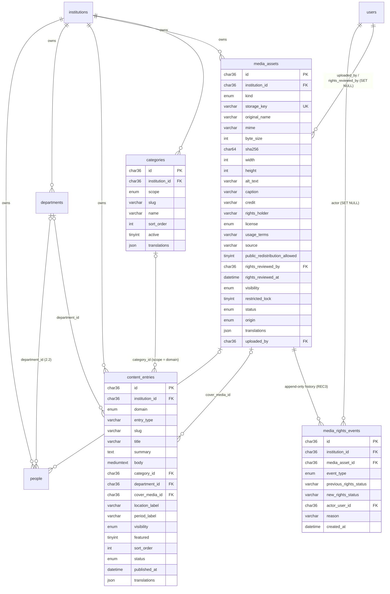

# Phase 2.3 architecture — Categories, Media Library, Culture & Heritage

| | |
| --- | --- |
| **Status** | **Revision 5 — decisions closed.** Authoritative for implementation (see also `PHASE_2_3_IMPLEMENTATION_HANDOFF.md`). Approved register §11.1; Bureau-open items §11.2; deferred slice §11.3. **Nothing implemented yet.** |
| **Base commit** | `bcd114e` (revision 1; revisions 2–5 uncommitted documentation) |
| **Parent plan** | `docs/architecture/PHASE_2_CONTENT_ARCHITECTURE.md` (this document refines its §`categories`, §`media_assets`, §`content_entries`) |
| **Findings** | `docs/audits/PHASE_2_3_ARCHITECTURE_REPORT.md` |

This is the Bureau's institutional website. Culture and Heritage are the Bureau's **documentation archive** (what the Bureau records, protects and publishes), not visitor discovery listings. No VisitHarar-style ratings, bookings, "things to do" framing or itineraries.

### Revision history

| Rev. | Change |
| --- | --- |
| 1 | Initial proposal (`bcd114e`) |
| 2 | Mandatory GD re-encoding; explicit media visibility; safer backfill; restricted heritage entries |
| 3 | Media rights and provenance; backfill by reference/rights status; restricted-media protection; static-image policy (pending D14); decision register corrected |
| 4 | Legacy cover exception (REC1), go-live unverified covers (REC2), rights audit trail (REC3) documented as recommendations; D14/D15/D16 pending; consistency pass |
| 5 | **Decision closure:** REC1–REC3, D1, D2, D5, D9–D16, D13 **approved**; D6/D7 remain Bureau-open; D8 deferred. Implementation handoff added. No code. |

---

## 1. Summary of recommendations

| Topic | Recommendation |
| --- | --- |
| Categories | One `categories` table with a fixed `scope`. **One category per item** (nullable FK). `active` flag instead of status. Never hard-deleted. |
| Media | `media_assets` registry with **rights and provenance** fields. Files stay on disk **outside the web root**, served only through PHP after a registry lookup. Every asset starts `cms_only`. An asset becomes public only through a **separate admin approval** that requires verified redistribution rights. Rights admin actions write an append-only audit trail (**REC3 approved**). |
| Upload security | Type verified from content (finfo **and** `getimagesize`) and size/pixel limits checked **before** decoding. **Every image is decoded and re-encoded with GD**; only the re-encoded output is stored. **Static images only** (JPEG, PNG, WebP, static GIF; animated GIF/APNG/WebP rejected — **D14**). Server-generated names, hardened response headers, per-user daily quota. Pixel/dimension limits **D15** (24 MP / 8,000 px edge / 2,560 px stored). |
| Culture & Heritage | One `content_entries` table with `domain` (`culture`/`heritage`) and a code-validated `entry_type`. One cover image. Heritage entries can be `restricted` (CMS-only), and **their media is locked out of every public surface**. Gallery deferred (purely additive later). |
| CMS | One shared editor component, mounted as two CMS sections (**Culture**, **Heritage**) with the domain fixed by route. A Media library with a rights review queue, a reusable media picker, and a Categories page. |
| Translations | Keep the existing `translations` JSON pattern. Add per-field fallback reporting so pages can mark English fallback text with `lang="en"`. |
| Migrations | `009_categories_media.sql` and `010_content_entries.sql` (+ rollbacks). A PHP CLI backfill (dry-run by default) classifies existing files by reference status and rights status and never makes anything public without a reviewed rights record. |
| Public | `/culture`, `/culture/:slug`, `/heritage`, `/heritage/:slug` with type/category filters, server-side search and "load more" pagination. Restricted entries and their media are excluded everywhere. |

Out of scope for 2.3: PDF uploads (designed below, not built), news/events/services/documents changes (2.4), freeform pages (2.5), a **general** CMS audit log or content-approval workflow, new roles, identity changes. A **rights-only** append-only event log (**REC3**) is in scope for 2.3 and does not create a general audit product.

---

## 2. Entity relationship diagram



All cross-table links use **composite foreign keys** `(institution_id, x_id) → parent(institution_id, id)` with `ON DELETE RESTRICT`, as `people → departments` does in 2.2. That makes cross-institution links impossible at the database level. (`ON DELETE SET NULL` cannot be used on these composite keys because it would also null `institution_id`.)

---

## 3. Proposed schema

### 3.1 `categories`

| Column | Type | Notes |
| --- | --- | --- |
| `id` | CHAR(36) PK | `uuid_v4()` |
| `institution_id` | CHAR(36) NOT NULL | FK → `institutions` CASCADE |
| `scope` | ENUM(`culture`,`heritage`,`news`,`events`,`documents`,`services`,`general`) NOT NULL | Fixed after create |
| `slug` | VARCHAR(255) NOT NULL | |
| `name` | VARCHAR(255) NOT NULL | English base |
| `sort_order` | INT NOT NULL DEFAULT 0 | |
| `active` | TINYINT(1) NOT NULL DEFAULT 0 | Created inactive |
| `translations` | JSON NOT NULL DEFAULT `'{}'` | `{am:{name}, om:{name}, ha:{name}}`, CHECK object |
| `created_at`, `updated_at` | DATETIME(3) | |

Keys: UNIQUE `(institution_id, scope, slug)`, UNIQUE `(institution_id, id)` (composite FK target), KEY `(institution_id, scope, active, sort_order)`.

Design decisions:

- **Scope is a column, not separate tables.** One CMS screen and one API serve all seven scopes. News/events/documents/services scopes are created now but **not wired** to those tables until 2.4.
- **Same slug in different scopes is allowed** (`culture/music` and `events/music`), because public filters are always scoped.
- **One category per item** (**D1 approved**). A second axis already exists for culture/heritage (`entry_type`), so type × category covers the realistic filtering needs. Multiple categories would need a join table, tag-style UI and many-to-many filtering; that's deferred and can be added later without breaking the single FK.
- **Lifecycle is `active` only** (no draft/published/archived). A category is vocabulary, not content.
  - **Publish gate equivalent** (**D2 approved**): editors can create and edit categories, but only admins can set `active = 1`. Editor-created categories stay inactive until an admin activates them. This reuses `ContentPolicy::canPublish`, not a new role.
  - **Deactivating while referenced is allowed.** Items keep their `category_id`; public responses omit inactive categories (`category: null`) and filters hide them. Nothing breaks and the change is reversible.
  - **No hard delete.** No DELETE route; `DELETE` deactivates. The FK `RESTRICT` blocks accidental SQL deletes of referenced rows.
- **Scope must match the content domain.** `content_entries.domain = categories.scope` is checked in PHP (a DB-level check would need a generated column in the FK, which isn't worth it).
- **Category names are public vocabulary.** A category used only by restricted entries is still listed publicly if active (it reveals a topic, not a record). Public counts never include restricted entries (R3).

### 3.2 `media_assets`

| Column | Type | Notes |
| --- | --- | --- |
| `id` | CHAR(36) PK | |
| `institution_id` | CHAR(36) NOT NULL | FK → `institutions` CASCADE |
| `kind` | ENUM(`image`,`document`) NOT NULL | Extend the ENUM later (`audio`, `video`) without redesign |
| `storage_key` | VARCHAR(64) NOT NULL | `{uuid}.{ext}`, server-generated, extension of the **re-encoded output**. UNIQUE globally. Changed (re-keyed) when an asset is locked (§4.6) |
| `original_name` | VARCHAR(255) NULL | Sanitized, **display only**, never used for paths |
| `mime` | VARCHAR(100) NOT NULL | Type of the stored (re-encoded) file |
| `byte_size` | INT UNSIGNED NOT NULL | Of the stored file |
| `sha256` | CHAR(64) NOT NULL | Of the stored file. Integrity, duplicate warning |
| `width`, `height` | INT UNSIGNED NULL | Images only, of the stored file |
| `alt_text` | VARCHAR(500) NULL | English base. Required for public approval |
| `caption` | VARCHAR(1000) NULL | |
| `credit` | VARCHAR(255) NULL | Attribution line shown publicly (e.g. "Photo: …"). Required for `cc_by` / `cc_by_sa` |
| **`rights_holder`** | VARCHAR(255) NULL | Who owns the rights (person, organisation, "Harari Culture, Heritage & Tourism Bureau") |
| **`license`** | ENUM(`unknown`,`bureau_owned`,`permission_granted`,`cc0`,`cc_by`,`cc_by_sa`,`public_domain`) NOT NULL DEFAULT `unknown` | Usage basis. **D16 approved** — preserve these exact values |
| **`usage_terms`** | VARCHAR(1000) NULL | Scope and limits of permission, reference to the permission letter or agreement. Required for `permission_granted` |
| **`source`** | VARCHAR(500) NULL | Provenance: who supplied it, when, original archive or collection reference |
| **`public_redistribution_allowed`** | TINYINT(1) NOT NULL DEFAULT 0 | Set only by an admin rights review (§4.5) |
| **`rights_reviewed_by`** | CHAR(36) NULL | FK → `users` ON DELETE SET NULL. Admin who approved or revoked |
| **`rights_reviewed_at`** | DATETIME(3) NULL | |
| `visibility` | ENUM(`public`,`cms_only`) NOT NULL DEFAULT `cms_only` | Rules in §4.4 |
| **`restricted_lock`** | TINYINT(1) NOT NULL DEFAULT 0 | Set when the asset is linked to a restricted heritage entry (§4.6) |
| `status` | ENUM(`active`,`archived`) NOT NULL DEFAULT `active` | |
| `origin` | ENUM(`upload`,`backfill`) NOT NULL DEFAULT `upload` | |
| `translations` | JSON NOT NULL DEFAULT `'{}'` | `{am:{alt_text, caption}, …}`, CHECK object |
| `uploaded_by` | CHAR(36) NULL | FK → `users` ON DELETE SET NULL (single-column FK, so SET NULL is safe). NULL for backfilled rows |
| `created_at`, `updated_at` | DATETIME(3) | |

Keys: UNIQUE `(storage_key)`, UNIQUE `(institution_id, id)`, KEY `(institution_id, kind, status, created_at)`, KEY `(institution_id, visibility, public_redistribution_allowed)` (review queue), KEY `(institution_id, sha256)`, KEY `(uploaded_by, created_at)` (quota check).

**Database CHECK constraints** (defence in depth; the API enforces the same rules with clear messages):

- `public_redistribution_allowed = 0 OR (license <> 'unknown' AND rights_holder IS NOT NULL AND source IS NOT NULL AND rights_reviewed_at IS NOT NULL)`
- `visibility = 'cms_only' OR (public_redistribution_allowed = 1 AND restricted_lock = 0 AND status = 'active' AND alt_text IS NOT NULL)`

The second constraint makes it impossible, even by direct SQL, to have a public asset without approved rights, with a restricted lock, archived, or without alt text.

Rules:

- **Archive instead of delete.** Archived assets stop being served and vanish from the picker. Archiving is blocked with 409 while published public content or a published person references the asset; to remove an image from public view urgently, use **Withdraw** (V3), which is never blocked.
- **No in-place replacement in 2.3.** To change an image, upload a new asset and re-point the content, so URLs stay stable and caches stay correct.
- **Hard purge** (delete row + file) is deferred. When built: admin-only, only for archived and unreferenced assets, DB delete first, then file unlink.
- **Reuse:** one asset can be the cover for several entries and a person's photo, subject to the restricted-media rules (§4.6). Content stores only `*_media_id`.

### 3.3 `content_entries`

| Column | Type | Required | Notes |
| --- | --- | --- | --- |
| `id` | CHAR(36) PK | ✔ | |
| `institution_id` | CHAR(36) | ✔ | FK CASCADE |
| `domain` | ENUM(`culture`,`heritage`) | ✔ | **Fixed after create** (**D9 approved**; avoids changing public URLs) |
| `entry_type` | VARCHAR(32) | ✔ | Validated in PHP against the vocabulary below |
| `slug` | VARCHAR(255) | ✔ | UNIQUE `(institution_id, slug)` across both domains |
| `title` | VARCHAR(255) | ✔ | English base |
| `summary` | TEXT | | ≤ 2,000 chars, used for cards and meta description |
| `body` | MEDIUMTEXT | | ≤ 50,000 chars, plain text with paragraphs (same as other content) |
| `category_id` | CHAR(36) NULL | | Composite FK → `categories`; scope must equal domain |
| `department_id` | CHAR(36) NULL | | Composite FK → `departments` (responsible unit) |
| `cover_media_id` | CHAR(36) NULL | | Composite FK → `media_assets`; image only. Publicly servable to publish a public entry (V4); locked for restricted entries (§4.6) |
| `location_label` | VARCHAR(255) NULL | | e.g. "Harar Jugol, near Showa Gate". Mostly heritage |
| `period_label` | VARCHAR(128) NULL | | e.g. "16th century". Free text: dates in heritage are rarely exact |
| `visibility` | ENUM(`public`,`restricted`) NOT NULL DEFAULT `public` | ✔ | `restricted` allowed only when `domain = heritage` (PHP check). Rules in §4.6 |
| `featured` | TINYINT(1) DEFAULT 0 | | Changing it on published entries is subject to the publish gate. Ignored for restricted entries |
| `sort_order` | INT DEFAULT 0 | | |
| `status` | ENUM(`draft`,`published`,`archived`) DEFAULT `draft` | ✔ | Existing publish gate |
| `published_at` | DATETIME(3) NULL | | Set on first publish, kept on later edits |
| `translations` | JSON NOT NULL DEFAULT `'{}'` | | `{am:{title,summary,body,location_label,period_label}, …}` |
| `created_at`, `updated_at` | DATETIME(3) | | |

Keys: UNIQUE `(institution_id, slug)`, KEY `(institution_id, domain, visibility, status, featured, sort_order, published_at)`, KEY `(institution_id, category_id)`, KEY `(institution_id, department_id)`, KEY `(institution_id, cover_media_id)`. All FKs `RESTRICT`.

**Entry type vocabulary** (a PHP constant, so changing it needs no migration; **D7 open — Bureau to confirm or adjust**):

| Domain | `entry_type` values |
| --- | --- |
| `culture` | `tradition`, `language`, `cuisine`, `music_dance`, `clothing`, `craft`, `practice`, `documentation` |
| `heritage` | `historic_site`, `building`, `object`, `manuscript`, `documentation` |

Translated labels come from the UI catalogs (`contentTypes.culture.tradition` …), not the DB.

**Deliberately not included:** latitude/longitude (no map feature is planned, and exact coordinates are the most sensitive heritage data; additive later), a gallery join table (`content_entry_media`, **D5 approved — later**), rich-text HTML (keeps XSS surface at zero), tags.

### 3.4 Change to `people` (completes the 2.2 deferral)

`ALTER TABLE people ADD photo_media_id CHAR(36) NULL` + composite FK → `media_assets` RESTRICT. The person form gets the media picker; `/organization` shows the photo with translated alt text. A published person's photo must be publicly servable (V4), and a locked asset can't be used as a person's photo (RM2).

### 3.5 `media_rights_events` (REC3 — approved)

Append-only history of every rights-related administrative action. Designed so ordinary CMS users and ordinary API paths cannot edit or delete rows. **Required in 2.3.**

| Column | Type | Notes |
| --- | --- | --- |
| `id` | CHAR(36) PK | |
| `institution_id` | CHAR(36) NOT NULL | FK → `institutions` CASCADE |
| `media_asset_id` | CHAR(36) NOT NULL | Composite FK → `media_assets` RESTRICT (events outlive soft archive; hard purge deferred) |
| `event_type` | ENUM(`approve_public`,`mark_not_permitted`,`revoke_rights`,`rights_fields_amended`) NOT NULL | Approval, rejection ("not permitted"), revocation, and admin amendment of already-reviewed fields |
| `previous_rights_status` | VARCHAR(32) NOT NULL | Derived status before the action (`unknown` / `proposed` / `incomplete` / `approved` / `not_permitted`) |
| `new_rights_status` | VARCHAR(32) NOT NULL | Derived status after the action |
| `actor_user_id` | CHAR(36) NULL | FK → `users` ON DELETE SET NULL. The administrator who performed the action |
| `reason` | VARCHAR(1000) NOT NULL | Required free-text reason (UI enforces non-empty) |
| `snapshot_json` | JSON NOT NULL | Immutable copy of rights fields at the time of the action (`license`, `rights_holder`, `source`, `usage_terms`, `credit`, `public_redistribution_allowed`, `visibility`) |
| `created_at` | DATETIME(3) NOT NULL | Server clock; never updated |

Keys: KEY `(institution_id, media_asset_id, created_at)`, KEY `(institution_id, event_type, created_at)`.

**Protection against ordinary modification or deletion:**

- Application layer: no PUT/PATCH/DELETE route for this table. Only INSERT from the rights-action endpoints, inside the same transaction as the `media_assets` update.
- Database: a MariaDB trigger (or equivalent) rejects UPDATE and DELETE on `media_rights_events` for application accounts. Schema changes require a DBA / migration, not the CMS.
- Role: only admins can cause inserts (same gate as the rights actions themselves). Editors cannot write events.
- Retention: events are kept indefinitely in 2.3; any future purge is a separate, documented ops procedure outside the CMS.

P5 continues to forbid a **general** CMS audit product; REC3 is the approved rights-only carve-out.

---

## 4. Media security and storage design

### 4.1 Threats and controls

| Threat | Control |
| --- | --- |
| **Malicious upload / script execution** | Files are written only to `uploads_dir`, which must be **outside every web root**. Never served by the web server directly, only by `MediaController`, with `Content-Type` taken from the registry. Allowed input types exclude SVG, HTML, XML and anything scriptable. Generated `{uuid}.{ext}` names mean `shell.php.jpg`-style tricks have nothing to act on. Defence in depth: a `storage/.htaccess` with `Require all denied` plus `RemoveHandler`/`php_flag engine off` for hosts that misplace the folder. |
| **MIME spoofing** | The browser's `type` and filename are ignored. Input type = `finfo(FILEINFO_MIME_TYPE)` on the temp file, must be in the allowlist, **and** `getimagesize()` must succeed with a matching `IMAGETYPE_*`. The current 3-byte magic fallback that accepts files finfo rejected is removed. Finally GD must decode the file; anything that doesn't decode is rejected. |
| **Extension spoofing** | Stored extension comes from the **output** format GD wrote, never from the client. |
| **Polyglots** (valid image header + HTML/JS/PHP payload) | **Removed by re-encoding.** The uploaded bytes are never stored; GD decodes to pixels and writes a fresh file, so appended or embedded payloads don't survive. Response headers (`nosniff`, `CSP: default-src 'none'; sandbox`, exact `Content-Type`) remain as defence in depth. |
| **Metadata leakage (EXIF GPS, camera serials, author tags)** | **Removed by re-encoding.** GD writes no EXIF/XMP/IPTC. JPEG orientation is applied from EXIF (via the `exif` extension) **before** stripping, so photos aren't stored sideways. Provenance the Bureau needs is recorded deliberately in `source` / `rights_holder` instead. |
| **Animated or multi-frame images** | Rejected (static-image policy, §4.3, **D14 approved**). GD would silently keep only the first frame, so animation is detected and refused rather than altered. |
| **Oversized files / decompression bombs** | Bytes: images ≤ 5 MB (unchanged), PHP `upload_max_filesize=8M`. Pixels (**D15**): ≤ 24 megapixels and ≤ 8,000 px per edge, checked from `getimagesize` (header only) **before** GD allocates memory. The upload route raises `memory_limit` to 256 MB for decoding. **nginx needs `client_max_body_size 10m`** (currently defaults to 1 MB in `deploy/nginx.conf`). |
| **Image-decoder vulnerabilities** (GD/libjpeg/libpng/libwebp) | Decoding untrusted images is attack surface. Mitigated by the pre-decode pixel/byte limits, editor-only upload access, and keeping the base image patched (rebuild the API image on PHP security releases). |
| **Publishing without rights** | No asset is public by default. Public approval requires an admin rights review with a known licence, rights holder and source; enforced in the API and by a DB CHECK (§3.2, §4.5). |
| **Disk exhaustion** | Per-user quota: ≤ 100 uploads per rolling 24 h (one `COUNT(*)` on `(uploaded_by, created_at)`). Refuse uploads when `disk_free_space(uploads_dir)` < 500 MB (**D12 approved**). |
| **Path traversal** | Public route accepts only `^[0-9a-f-]{36}\.(jpg|png|webp|gif)$`, and the key must exist in `media_assets` for the current institution. `Content-Type` comes from the registry `mime`. CMS file route takes a UUID `id` only. No user input ever reaches a filesystem path. |
| **Unauthorized private access** | Anything not publicly servable (V7) gets 404 on the public route (not 403, to avoid confirming existence). The CMS route requires a session (viewer+) and sends `Cache-Control: private, no-store`. |
| **Cross-institution access** | Every lookup includes `institution_id = Db::institutionId()`. Composite FKs stop content from referencing another institution's asset. Isolation is enforced by the registry, not by directory layout. |
| **Unsafe filenames** | `original_name` is stripped of path components, control characters and bidi overrides, normalised and truncated to 255. It's shown escaped in the CMS and never used to build a path or a `Content-Disposition` header. |
| **Sensitive media exposure via restricted heritage** | Restricted-media lock, re-keying and a single public-serving predicate (§4.6). |
| **Draft / archived exposure** | Every asset starts `cms_only`. Archived assets are never served. Caching drops from `immutable, 1 year` to `public, max-age=86400` (**D11 approved**). |
| **CSRF / role abuse** | Unchanged: double-submit CSRF on all mutations, editor+ to upload or edit metadata, admin to activate categories, publish content, approve rights and public visibility, lift restrictions, or clear a restricted lock. |

### 4.2 Where files live

- **Docker / VPS:** keep `backend/storage/uploads/`. It's already outside `backend/public/` (the PHP document root), and `router.php` only serves files under `public/`, so this layout is correct.
- **Quarantine:** `backend/storage/quarantine/` and **backfill originals:** `backend/storage/backfill-originals/{date}/`. Same rules: outside the web root, deny-all `.htaccess`, not served by any route.
- **Shared hosting (D13 approved):** put `storage/` (and preferably `app/`, `config/`) **above** `public_html` and point `config.php → uploads_dir` there. Never leave uploads web-reachable. Deny-all `.htaccess` inside `storage/` is defence in depth, not a substitute for correct placement. See updated `docs/FULL_MIGRATION_MAP.md`.
- No per-visibility directories: a file doesn't move when its visibility changes; the controller decides. The only rename is re-keying on lock (§4.6).

### 4.3 Upload pipeline — mandatory GD re-encoding, static images only

**Runtime requirement:** PHP `gd` built with JPEG, PNG and WebP support, plus `exif`. The current API image has neither. 2.3 adds them to `backend/docker/Dockerfile` (`docker-php-ext-configure gd --with-jpeg --with-webp` + `docker-php-ext-install gd exif`, with the matching `-dev` packages). Shared hosts usually ship both; this must be verified before deploy.

**Fail closed:** if `gd` or a required codec (`imagecreatefromjpeg`, `imagecreatefrompng`, `imagecreatefromwebp`, `imagecreatefromgif`, `imagewebp`, `imagegif`) is missing, `POST /api/cms/media` returns **503 "Image processing is unavailable"** and stores nothing. There is no path that stores an un-re-encoded image. `GET /api/cms/media/capabilities` (viewer+) reports this, so the CMS can disable the upload button with an explanation, and a CLI preflight (`php bin/check-media-env.php`) is part of the deploy checklist.

**Static-image policy (one policy for uploads and backfill; D14 approved):**

| Input | Accepted when | Stored as |
| --- | --- | --- |
| JPEG | Always (single frame by format); validated and GD-re-encoded | JPEG, quality 85, progressive |
| PNG | No `acTL` chunk before the first `IDAT` (i.e. not APNG); validated and GD-re-encoded | PNG, compression 6, alpha preserved |
| WebP | Not animated (no `ANIM`/`ANMF` chunks in the RIFF container); validated and GD-re-encoded | WebP, quality 85, alpha preserved |
| Static GIF | Exactly **one** image descriptor (block walk over the GIF stream); validated and GD-re-encoded | **GIF, static**, re-encoded with `imagegif` (GIF is already 256-colour, so this is lossless for static images) |
| Animated GIF / APNG / animated WebP | **Never** — upload: 400 "Animated images are not supported. Upload a still image."; backfill: `quarantine`. Never silently converted or published. | — |

Animation is rejected rather than reduced to the first frame, because silently changing what the Bureau uploaded is worse than a clear refusal. Preserving animation would need frame-by-frame re-encoding that GD doesn't provide; it isn't planned. The frame detectors are small byte-level checks, each covered by fixtures (a static and an animated sample per format) in the smoke test. **D14 is approved.**

Steps:

1. `ContentPolicy::requireEditor()`; CSRF already enforced by the front controller.
2. GD capability check (fail closed, above). Quota and free-disk checks.
3. `is_uploaded_file`, size ≤ 5 MB.
4. finfo input type ∈ {`image/jpeg`, `image/png`, `image/webp`, `image/gif`} **and** `getimagesize` succeeds with a matching type, **and** the pixel limits hold, **and** the static-image check passes. All checks happen before decoding.
5. Decode with the matching `imagecreatefrom*`. A decode failure → 400 "This image could not be processed."
6. JPEG only: apply EXIF orientation (`exif_read_data` → rotate/flip). Unreadable EXIF is ignored, not fatal.
7. Downscale proportionally if the longest edge > 2,560 px (**D15**; the CMS already resizes to 2,000 px client-side).
8. Re-encode to a fresh temp file in `uploads_dir`, same format as the input (table above). ICC colour profiles are dropped (sRGB assumed); wide-gamut photos may shift slightly.
9. `getimagesize` on the output (sanity check), then `sha256_file`, size and dimensions **of the output**.
10. Atomic `rename` to `{uuid}.{ext}` and `chmod 0640`. The original temp upload is discarded by PHP at request end; it is never moved into storage.
11. Insert the `media_assets` row: `visibility = cms_only`, `license = unknown`, `public_redistribution_allowed = 0`, `origin = upload`, plus any rights fields the uploader proposed. **If the insert fails, unlink the file** (no orphans).
12. Return the asset JSON (`id`, `url: null`, `previewUrl` = the authenticated CMS file route, `width`, `height`, rights status, …).

### 4.4 Media visibility rules

Making a file reachable by anyone on the internet is its own decision. It needs an admin, verified rights, and is **never a side effect of saving or publishing content**.

**Publicly servable predicate.** One SQL fragment / helper, used by the public file route **and** by every public JSON builder (covers, person photos, `og:image`):

```
institution_id = :inst AND visibility = 'public' AND status = 'active'
AND public_redistribution_allowed = 1 AND restricted_lock = 0
```

| Rule | Detail |
| --- | --- |
| **V1 — Default** | Every new asset is `cms_only`, wherever it was uploaded: library, picker, person form, or the legacy `ImageField` used by news/services. |
| **V2 — Public approval is separate** | Only an **admin**, only via `POST /api/cms/media/{id}/approve-public`. Preconditions: `status = active`, `restricted_lock = 0`, `alt_text` present, and the rights review passes (§4.5). The action records `rights_reviewed_by/at`, sets `public_redistribution_allowed = 1` and `visibility = public` in one transaction. No content endpoint can change any of these fields. |
| **V3 — Withdraw** | `POST /api/cms/media/{id}/withdraw` sets `visibility = cms_only`. **Editor+, always allowed** (reducing exposure is always permitted, like restricting an entry). The CMS confirmation lists published content and people that will stop showing the image. |
| **V4 — Publishing content checks, never changes, media** | Publishing (or saving while published) a **public** entry or person whose cover/photo is not publicly servable returns 400 naming the asset. The editor shows a link to the asset's review panel; approving it is a separate admin action (V2). Content publication never alters asset state. |
| **V5 — Drafts and restricted entries** | Drafts of public entries may reference any non-locked asset, including `cms_only` ones. Restricted entries may reference only `cms_only` assets, and doing so locks them (RM1). CMS previews use the authenticated file route. |
| **V6 — After withdrawal or revocation** | Published content that references a no-longer-servable asset stays published. Its public response returns `cover: null` / `photo: null`, and the CMS shows a "Cover not public" warning. Nothing breaks and nothing leaks. |
| **V7 — Serving** | Public route: publicly servable → 200; anything else → 404. CMS route: any asset of this institution → 200 for viewer+, `private, no-store`. |
| **V8 — Caching** | Public responses `public, max-age=86400` (**D11 approved**). |
| **V9 — Picker** | Shows active assets with badges for visibility, rights status and lock. Locked assets are hidden from the picker when editing a public entry or a person. |
| **V10 — Legacy news/services covers** | **REC1 approved:** no automatic public exception. Legacy `ImageField` uploads are `cms_only` like everything else, so a newly uploaded news/services cover shows publicly only after an admin approves it (V2). The `ImageField` hint says so. "Used by" detection covers legacy URL columns (`news.cover_image`, `services.cover_image`, `documents.file_url`, `pages.content`) by storage-key match. 2.4 replaces these URL columns with `cover_media_id`. |
| **V11 — Future documents (PDF)** | Same rules, same predicate. |

### 4.5 Rights and provenance

An image existing on disk, being used by published content, or having been publicly served before **does not establish redistribution rights**. Rights are recorded and reviewed per asset.

**Rights status** (derived, shown as a badge and used in the backfill report):

| Status | Condition |
| --- | --- |
| `unknown` | `license = unknown` and no rights fields |
| `proposed` | Some rights fields filled, not yet reviewed |
| `incomplete` | Reviewed fields fail validation (below) |
| `approved` | `public_redistribution_allowed = 1` |
| `not_permitted` | Reviewed and explicitly marked as not redistributable (`public_redistribution_allowed = 0` with `rights_reviewed_at` set). The asset can still be used inside the CMS and on restricted entries |

**Validation for approval** (API and DB CHECK):

- `license ≠ unknown`, `rights_holder` and `source` non-empty.
- `permission_granted` → `usage_terms` required (scope plus reference to the written permission).
- `cc_by`, `cc_by_sa` → `credit` required, and the public cover object includes `credit` and the licence label.
- `bureau_owned` → `rights_holder` must name the Bureau; `source` records who produced it (staff photographer, commissioned work).
- `alt_text` present (accessibility gate, same moment).

**Who may do what:**

| Action | Role |
| --- | --- |
| Propose or edit rights fields while not approved | editor+ |
| Edit rights fields of an **approved** asset | admin only; the change must remain valid and re-stamps `rights_reviewed_by/at`; writes a `rights_fields_amended` event (**REC3**) |
| Approve rights and make public (V2) | admin; requires a non-empty reason (**REC3**) |
| Mark not permitted (`POST /api/cms/media/{id}/mark-not-permitted`) | admin; rejection event (**REC3**) |
| **Revoke** rights (`POST /api/cms/media/{id}/revoke-rights`) | admin. Sets `public_redistribution_allowed = 0` and `visibility = cms_only` together (required by the CHECK). Always allowed; impact list shown; revocation event (**REC3**) |
| Withdraw from public without revoking rights (V3) | editor+ (visibility only; not a rights event) |
| Read rights event history | viewer+ (CMS detail); no public exposure |

**CMS review workflow:**

1. On upload, the form asks for credit, rights holder, licence, usage terms and source (all optional at upload, so drafting isn't blocked). Licence values are the vocabulary in §3.2 (**D16 approved**).
2. The Media library has a **"Rights review"** queue: assets referenced by any content or person, or with proposed rights, that are not yet `approved` or `not_permitted`. Backfilled assets appear here first.
3. An admin opens the asset, checks the fields against the permission evidence (kept outside the system), enters a reason, and either:
   - approves for public use, which ticks "I confirm the Bureau may redistribute this image publicly" (V2), or
   - marks it "Not for public redistribution" (sets `rights_reviewed_at` only).
4. Revocation later is always possible and immediately removes the image from public responses (V6).
5. **REC3:** every approve / mark-not-permitted / revoke / admin amendment inserts one `media_rights_events` row in the same transaction (asset id, previous status, new status, actor, timestamp, reason, field snapshot). The CMS detail drawer shows a read-only history. There is no UI or API to edit or delete events.

Rights fields are not translated. `source` and `usage_terms` are **never** included in public responses; `credit` and, for CC licences, the licence label are. Event history is CMS-only.

### 4.6 Restricted heritage entries and restricted-media protection

Some heritage records (vulnerable sites, sacred or privately held objects, manuscripts) may need to be documented by the Bureau without being published.

**Entry rules:**

| Rule | Detail |
| --- | --- |
| **R1 — Scope** | `visibility = restricted` is allowed only for `domain = heritage`. Culture entries are always `public` (extendable later if the Bureau asks). |
| **R2 — Who** | Editors and admins may set `restricted` (moving to more restricted is always allowed). Only **admins** may change `restricted → public`, and doing so on a published entry is treated as publishing it (publish gate applies). |
| **R3 — Public exclusion** | Restricted entries are excluded from every public surface, **even when `status = published`**: lists, detail (404, not 403), search, counts, "more in this category", featured rows, the sitemap, and any future feed. All public queries include `visibility = 'public'`. |
| **R4 — CMS access** | Visible to all signed-in CMS users (viewer+), with a "Restricted" badge in lists and a banner in the editor. No new role. |
| **R5 — Media** | Governed by RM1–RM7 below. |
| **R6 — No leakage through relations** | Department and category public responses never list or count restricted entries. Slugs of restricted entries are reserved (unique key), but the public API never reveals that the slug exists. |
| **R7 — Limits of protection** | This is access control on the website, not secrecy. Anyone with a CMS account can read restricted entries, and database backups contain them. Truly confidential records should not be stored in this system. Stated in the CMS banner and the ops checklist. |

**Restricted-media protection:**

| Rule | Detail |
| --- | --- |
| **RM1 — Lock on link** | When a restricted entry gets a cover, or an entry with a cover becomes restricted, the server sets the asset's `restricted_lock = 1` in the same transaction. If the asset was public, it is **withdrawn** (`cms_only`) and **re-keyed**: the file is renamed to a new `{uuid}.{ext}` and `storage_key` updated, so the old public URL returns 404 immediately. This protective side effect is allowed for editor+ (it only reduces exposure). The response lists published content and people whose image is now hidden (V6). |
| **RM2 — Locked assets stay out of public use** | A locked asset can't be approved for public use (409), can't be attached to a public-visibility entry (any status) or a person (400), and is hidden from the picker in those contexts. It can be reused by other restricted entries. |
| **RM3 — Unlock is explicit** | Only an admin can clear `restricted_lock`, and only when **no** restricted entry (any status, including archived) references the asset. Clearing the lock doesn't make the asset public; normal approval (V2, §4.5) is still required. |
| **RM4 — One serving predicate** | `restricted_lock = 0` is part of the publicly servable predicate (§4.4) and of the DB CHECK on `visibility = public`. A bug in one JSON builder can't expose a locked asset through the file route, and vice versa. |
| **RM5 — No public media index** | There is no public endpoint that lists, searches or enumerates media; none is planned. Public search covers only public entries' text (R3). `og:image`, sitemap and JSON covers are all built with the servable predicate. |
| **RM6 — Metadata stays private** | Alt text, caption, credit, rights fields and `original_name` of a non-servable asset never appear in any public response. |
| **RM7 — Residual exposure** | Re-keying makes the old URL 404 at the origin immediately. Copies already cached by browsers or proxies may persist until their max-age (1 day; up to 1 year for files first served under the pre-2.3 `immutable` header). Purging any CDN is an ops step. The CMS confirmation for restricting an entry with a previously public cover says this explicitly. |

### 4.7 Future PDFs (designed, not built in 2.3)

- **Accepted type:** finfo `application/pdf` **and** a `%PDF-` header, ≤ 20 MB, `kind = document`.
- **Visibility and rights:** same as images — default `cms_only`, rights review required, same servable predicate (V11).
- **Public download:** `Content-Disposition: attachment` by default, with an option for inline viewing under the same `CSP sandbox`.
- **No server-side re-encoding or parsing.** PDFs can carry JavaScript and embedded files; they can't be neutralised like images, so public approval stays an admin action and malware scanning (ClamAV) is a hosting decision.
- **Office formats (docx/xlsx)** would need ZIP container checks. Exclude them until there's a real need.

---

## 5. API contracts

Conventions follow existing code:
- JSON throughout; lists are `{items}`.
- `?lang=en|am|om|ha`.
- Errors use `json_error(status, code, message)`.
- CMS lists include all statuses and visibilities.
- `DELETE` archives (or deactivates) rather than deleting.

### 5.1 Public

| Method | Path | Notes |
| --- | --- | --- |
| GET | `/api/categories?scope=culture&lang=` | Active only, ordered `sort_order, name`. `scope` required. Returns `{slug, name, language, usedFallback}` |
| GET | `/api/culture?lang=&type=&category=&q=&featured=1&limit=24&offset=0` | Published only |
| GET | `/api/culture/{slug}?lang=` | Published only; 404 otherwise (including if the slug is a heritage entry) |
| GET | `/api/heritage…` | Same contract with `domain = heritage`; **`visibility = public` only** (R3) |
| GET | `/api/media/{storage_key}` | **Changed behaviour:** serves only publicly servable assets (§4.4); 404 otherwise |

List response (adds `total`, `limit`, `offset`; still `items` so existing client patterns work):

```json
{
  "items": [
    {
      "slug": "…", "domain": "heritage", "entryType": "building",
      "title": "…", "summary": "…", "locationLabel": "…", "periodLabel": "…",
      "featured": true, "publishedAt": "2026-…Z",
      "category": { "slug": "…", "name": "…" },
      "cover": { "url": "/api/media/….jpg", "alt": "…", "width": 1600, "height": 1067 },
      "language": "am", "usedFallback": true, "fallbackFields": ["summary"]
    }
  ],
  "total": 37, "limit": 24, "offset": 0
}
```

`cover` is `null` unless the asset is publicly servable (V6). Detail adds `body`, `department {slug,name}` (only if published, as in 2.2), and `cover.caption`, `cover.credit` and `cover.license` (CC licences only). Never exposed publicly: `id`, `status`, `visibility`, `institution_id`, raw `translations`, `uploaded_by`, `original_name`, `sha256`, `origin`, `rights_holder`, `usage_terms`, `source`, review fields, `restricted_lock`.

Filtering and validation:
- `type` must be in the domain's vocabulary (otherwise 400).
- `category` is a category slug within the domain scope; unknown or inactive slugs return an empty list, not an error.
- `limit` ≤ 50, `offset` ≤ 10,000.
- `q` is 2–100 chars. It does a `LIKE` on base `title`/`summary` and on the requested language's translated title/summary (`JSON_VALUE`), with `%`/`_` escaped, **only over public, published entries**. A FULLTEXT index is deferred until volume justifies it.
- Order: `featured DESC, sort_order ASC, published_at DESC`.
- `total` counts only public, published entries (R3).

### 5.2 CMS

| Method | Path | Role |
| --- | --- | --- |
| GET | `/api/cms/categories?scope=` | viewer+ |
| GET | `/api/cms/categories/{id}` | viewer+ |
| POST | `/api/cms/categories` | editor+ (`active` forced to 0 unless admin) |
| PUT | `/api/cms/categories/{id}` | editor+ (only admin may change `active`); `scope` immutable |
| DELETE | `/api/cms/categories/{id}` | admin — deactivates |
| GET | `/api/cms/media/capabilities` | viewer+ — `{ imageProcessing: bool, formats: [...] }` |
| GET | `/api/cms/media?kind=&status=&visibility=&rights=&locked=&origin=&q=&limit=&offset=` | viewer+ (`rights=review` gives the review queue) |
| GET | `/api/cms/media/{id}` | viewer+ (includes `usage`: entries, people and legacy URL references, with status and visibility; includes recent rights events or a link) |
| GET | `/api/cms/media/{id}/file` | viewer+, streams any asset of this institution, `private, no-store` |
| GET | `/api/cms/media/{id}/rights-events` | viewer+ — append-only history (**REC3**) |
| POST | `/api/cms/media` | editor+ (multipart: `file`, optional metadata and proposed rights). Always `cms_only`. 503 if GD is unavailable; 400 for animated images |
| PUT | `/api/cms/media/{id}` | editor+ for alt, caption, credit, translations and **proposed** rights fields; admin only once rights are approved. Visibility, `public_redistribution_allowed` and `restricted_lock` are **not** writable here |
| POST | `/api/cms/media/{id}/approve-public` | admin — body includes required `reason`; rights review + public (V2); inserts audit event |
| POST | `/api/cms/media/{id}/mark-not-permitted` | admin — body includes required `reason`; negative rights review + audit event |
| POST | `/api/cms/media/{id}/revoke-rights` | admin — body includes required `reason`; rights off and `cms_only` (§4.5) + audit event |
| POST | `/api/cms/media/{id}/withdraw` | editor+ — `cms_only` (V3) |
| POST | `/api/cms/media/{id}/unlock` | admin — clears `restricted_lock` (RM3) |
| DELETE | `/api/cms/media/{id}` | editor+ — archive; 409 if referenced by published public content |
| GET | `/api/cms/content-entries?domain=&type=&status=&visibility=&category=&q=&limit=&offset=` | viewer+ |
| GET | `/api/cms/content-entries/{id}` | viewer+ |
| POST | `/api/cms/content-entries` | editor+, publish gate, RM1 lock side effect |
| PUT | `/api/cms/content-entries/{id}` | editor+, publish gate; `domain` immutable; `restricted → public` admin only (R2); RM1 lock side effect |
| DELETE | `/api/cms/content-entries/{id}` | editor+ — archive (lock remains until RM3) |

Server-side validation for content entries:
- `entry_type` must be in the vocabulary for the domain; `visibility = restricted` only for heritage (R1).
- The category must exist in this institution, be in the same scope, and be active (an unchanged existing link is allowed, as in 2.2).
- The department must exist and not be archived.
- The cover must be an image of this institution. On a **public** entry it must not be locked (RM2), and to publish it must be publicly servable (V4). On a **restricted** entry it must be `cms_only`; a public asset is withdrawn, re-keyed and locked by RM1, with the impact listed in the response.
- Text goes through `plain_text()` with limits; translations go through `normalize_translations()`.

---

## 6. CMS workflows

**Navigation:** a new "Heritage & culture" group in `CmsLayout` with **Culture**, **Heritage**, **Media library** and **Categories**.

**Culture / Heritage (one component, two mounts):** `/cms/culture`, `/cms/culture/new`, `/cms/culture/:id`, and the same for heritage. The route fixes the domain, so editors never pick it and the type list and category list are already scoped. One shared component is less code than two near-identical editors, and two menu entries match how the Bureau thinks about its work.

**Edit form** sections:
- **Details:** title, slug (auto), type, category, department, location, period, featured, display order, status. Heritage only: **Visibility** (Public / Restricted) with the R7 explanation.
- **Summary and body.**
- **Cover:** media picker, showing the chosen image's visibility, rights status and lock badges, with warnings when it is not publicly servable, has no alt text, or (for restricted entries) will be withdrawn and locked on save.
- **Translations:** am/om/ha for title, summary, body, location and period.

It reuses `cms-page-form`, `cms-fieldset`, the dirty guard, read-only mode for viewers and the archive confirmation from `OrganizationPages.tsx`.

**Typical public flow:**
1. An editor uploads a photo (stored `cms_only`) and enters alt text, credit and the rights details they know.
2. The editor writes the entry and saves. It becomes a draft (publish gate).
3. An admin reviews the image in the **Rights review** queue and approves it for public use (separate action).
4. The admin reviews the entry, adds or checks translations, and publishes it. Publishing fails with a clear message if step 3 hasn't happened.

**Restricted heritage flow:** an editor creates a heritage entry, sets it to Restricted, attaches photos and saves. The photos are locked (RM1). An admin may set `status = published` to mark the record as approved internally; neither the entry nor its photos ever appear publicly. Lifting the restriction is a separate admin action, and the photos still need unlocking (RM3) and approval (V2) before any public use.

**Media library** (`/cms/media`):
- A grid of thumbnails (via the authenticated file route) with filters (kind, visibility, rights status, locked, status, origin) and a search on name or alt text.
- An upload button, disabled with an explanation when `capabilities.imageProcessing` is false.
- A detail drawer with the preview, metadata and translations, a **Rights & provenance** section, a "Used by" list (with restricted/draft/legacy badges), and the actions Approve for public use / Not permitted / Revoke / Withdraw / Unlock / Archive. Each is shown only to the roles allowed (§4.5) and disabled with an explanation when preconditions fail.
- A **Rights review** tab (queue from §4.5), with backfilled assets first.

**Media picker:** a dialog reused by the content editor and the person form. It shows active images with badges, hides locked images in public contexts (V9), offers "Upload new" inline, and returns an asset id. The existing `ImageField` (URL-based) stays for news and services until 2.4, under V10.

**Categories** (`/cms/categories`): a scope selector (tabs), a list ordered by display order, and an inline create/edit form with name, slug, order and translations. The Active toggle is shown only to admins; editors see "Inactive — an administrator must activate".

---

## 7. Multilingual approach

- **Base language: English.** Base columns hold English; `translations` holds `am`, `om` and `ha` objects. Same as pages, departments and people.
- **Translatable fields:**

  | Table | Fields |
  | --- | --- |
  | `categories` | `name` |
  | `media_assets` | `alt_text`, `caption` |
  | `content_entries` | `title`, `summary`, `body`, `location_label`, `period_label` |

  `credit`, rights fields, names and slugs are not translated. Licence labels shown publicly come from the UI catalogs.
- **Fallback:**
  - Per field: an empty translation falls back to English.
  - Each item reports `language`, `usedFallback` (as in 2.2), and the new `fallbackFields: [...]`. This is a small extension of the existing `resolve_translations()` helper.
  - The frontend wraps fallback fields in `lang="en"` so screen readers pronounce them correctly, and shows the existing notice ("Some details are shown in English …").
- **Alt text:**
  - The cover object's `alt` is resolved in the requested language, falling back to English.
  - Base-language alt text is required for public approval (§4.5); empty alt is never used for public covers.
  - The existing `CoverMedia alt=""` usage in news and services is a known accessibility gap, fixed in 2.4 when those tables get `cover_media_id`.
- **UI language vs content language:**
  - The UI language (cookie `lang`, `messages/*.json`) controls labels and is passed to the API as `?lang=`.
  - The content language is what the API actually returned, per field.
  - The two can differ; the page never claims a translation exists when it fell back.
- **Catalog honesty:** new UI keys go into all four catalogs. `ha` currently holds English text for many keys and still needs native review; this plan doesn't change that.

---

## 8. Public routes

| Route | Content |
| --- | --- |
| `/culture` | Intro (Bureau's role in documenting culture), featured entries, filter by type and category, search, card grid, "Load more" |
| `/culture/:slug` | Cover (with caption, credit and CC licence where applicable), title, type, category, period, location, responsible department, body, "More in this category" (up to 3, same API with `category=`) |
| `/heritage`, `/heritage/:slug` | Same templates with heritage copy. Restricted entries and their media are absent everywhere (R3, RM1–RM7); a restricted slug shows the normal 404 page |

- **Placement:** added to `App.tsx` before the `/:slug` catch-all. There are no existing page slugs `culture`/`heritage` (checked in the local DB, and `GUIDE_SLUGS` doesn't use them). `PagesController` should reserve both slugs so a future freeform page can't shadow them.
- **Filters:** state lives in the URL (`?type=&category=&q=`) using `useSearchParams`, like `ResourcesListPage`.
- **Search:** server-side `q`, debounced. Empty results show a "No entries match" message with a reset button.
- **Featured:** the first row shows featured entries; nothing is shown if none are featured.
- **Images:** the existing `CoverMedia` component (`thumb` / `hero` ratios), `loading="lazy"` on cards, width/height from the registry to prevent layout shift. Entries whose cover isn't publicly servable render without an image, not a broken one.
- **Empty states:** the `CatalogState` pattern from `/organization`: "The Bureau will publish verified culture/heritage documentation here" plus a contact link. **No placeholder entries are seeded.**
- **SEO:** `usePageHead` with the entry title and summary as description. `usePageHead` currently has no image parameter; add an optional `image` for `og:image`, filled only from a publicly servable cover. Detail pages use a canonical `/culture/{slug}`. Because this is an SPA, meta is client-side (a known limitation shared by all routes).
- **Sitemap:** add `/culture` and `/heritage` plus published **public** entries under the matching prefix. No image sitemap entries.
- **Responsive:** reuse the `news-listing` card grid and the 800px layout breakpoint. Filters collapse into a horizontally scrollable chip row on small screens.
- **Navigation** (**D6 open — Bureau**): recommended default for implementation until confirmed — link Culture and Heritage from the footer and the About page only. The primary-nav restructure (grouping under "Culture & Heritage") stays in 2.7, because the header already needed a 1100px collapse at seven items.

---

## 9. Migration plan

### 9.1 Files and ordering

Current numbering ends at `008`. Proposed files (not created in this documentation task):

| File | Creates / changes |
| --- | --- |
| `009_categories_media.sql` | `categories`, `media_assets` (incl. rights, provenance, lock, origin and the CHECK constraints), `media_rights_events` + append-only triggers (**REC3**), `ALTER people ADD photo_media_id` + FK |
| `009_categories_media.rollback.sql` | Drop FK + `people.photo_media_id`; drop `media_rights_events` (if present); drop `media_assets`; drop `categories` |
| `010_content_entries.sql` | `content_entries` (incl. `visibility`) |
| `010_content_entries.rollback.sql` | Drop `content_entries` |
| `backend/bin/check-media-env.php` | CLI preflight: GD + codecs + `exif` present; `uploads_dir`, quarantine and backfill-originals folders writable and outside the document root |
| `backend/bin/backfill-media.php` | CLI backfill (§9.2) |

- **Ordering:** `007 → 008 → 009 → 010 → preflight → backfill dry run → rights review of the report → backfill --apply → deploy code`. Both migrations come before the backfill so it can see every reference source (on a first run, `content_entries` is empty). The backfill must be applied **before** the new `MediaController` is deployed.
- **Go-live behavior for unverified legacy covers (REC2 — approved):**
  1. **Hidden by default.** An existing legacy cover is publicly visible after deploy **only** if its file was classified `published_public` **and** its rights were verified in the reviewed rights file. Every other legacy cover remains hidden (`cms_only` / not publicly servable).
  2. **Pages keep working.** Public pages that previously showed those images continue to function without them: list/detail responses return `cover: null` / omit the image; layouts must not break or show broken `` tags.
  3. **Complete inventory.** The backfill dry-run report is the inventory of affected records: every file with `live_impact` populated, plus `reference_status`, `references`, `rights_status`, `classification` and `proposed_visibility`. Operators keep a copy of `storage/backfill-report-{date}.csv` with the go-live packet.
  4. **Mandatory backups before migration.** Before applying `009`/`010` or running backfill `--apply`: take a full database dump **and** a complete copy of `storage/` (at least `uploads/`). Record backup paths and timestamps in the ops checklist. Do not proceed without both.
  5. **Recovery procedure.** If go-live must be reversed: (a) stop serving the new MediaController build; (b) restore the database from the pre-migration dump; (c) restore `storage/` from the pre-migration copy (or, for file-only damage after `--apply`, restore individual originals from `storage/backfill-originals/{date}/` using the report); (d) verify sample public pages and CMS login; (e) do not re-run `--apply` until the failure cause is understood. Rollback SQL alone does **not** restore files or re-keying.
  6. **Admin rights approval.** Images become publicly accessible again only after an administrator completes rights verification and public approval (V2). There is no automatic re-publication of unverified covers.
- **Safe defaults:**
  - `categories.active = 0`.
  - `media_assets.visibility = 'cms_only'`, `license = 'unknown'`, `public_redistribution_allowed = 0`, `restricted_lock = 0`.
  - `content_entries.status = 'draft'`, `content_entries.visibility = 'public'` (no effect until published).
  - `translations` defaults to `'{}'`.
  - New `people.photo_media_id` is NULL.
- **Idempotency:** `CREATE TABLE IF NOT EXISTS`. MariaDB supports `ADD COLUMN IF NOT EXISTS` and `ADD CONSTRAINT … FOREIGN KEY IF NOT EXISTS` for the `people` change. Tested with re-apply, like the 008 test.
- **Existing data:**
  - No existing content rows are modified.
  - News/services `cover_image` and documents `file_url` stay as text until 2.4.
  - Free-text `category` columns stay. The local DB shows VisitHarar-era values ("Mosques & Shrines", "Experience · …"), which must **not** be auto-converted into Bureau categories.
- **Rollback limitations:**
  - Rollback deletes all category, media-registry (including rights records) and entry data (including restricted entries).
  - It does **not** delete files, restore pre-backfill originals, undo re-keying, or move quarantined files back. Those are manual steps using the backfill report and backup folder.
  - Take a DB backup and a copy of `storage/` first.
  - Roll back 010 before 009.
- **Fresh databases:** Docker init loads only `001` and `002_seed_placeholder`. Apply 007–010 manually in order, as in 2.1/2.2. The backfill has nothing to do on an empty `uploads_dir`.
- **Manual-migration risk:** with ten numbered files and no record of what has been applied, drift between environments is likely. **D8** (deferred separate slice) proposes a minimal `schema_migrations` table and an apply script (the 2.1 brief excluded a migration runner from feature work).

### 9.2 Backfill: classification by references and rights

**Principle:** the backfill **never makes anything public on its own**. A file becomes public only when it is referenced by published public content **and** an admin has supplied a verified rights record for it. Draft and restricted material is never published by the backfill.

**Modes:**
- `php bin/backfill-media.php` — **dry run** (default). Reads only; writes the report.
- `php bin/backfill-media.php --apply --rights-file=reviewed.csv --reviewer=<admin email>` — performs the actions. It refuses to run unless the preflight passes, the reviewer is an active admin, and the rights file matches the current dry-run report (same file list and sha256 values).
- Idempotent: files already in the registry are skipped and reported as `already_registered`.

**Before `--apply`:** every file the run will change or move is copied to `storage/backfill-originals/{date}/`. Nothing is ever deleted.

**Step 1 — Validate** each file in `uploads_dir` without a registry row, exactly like a new upload: name matches `{uuid}.{ext}`; finfo type allowed; `getimagesize` matches; byte and pixel limits; static-image check (§4.3); GD decodes.

**Step 2 — Find references** by exact storage-key match (`LIKE '%{storage_key}%'`) and record each reference with its table, row id, status and visibility:
- `news.cover_image`, `news.content`
- `services.cover_image`, `services.description`
- `documents.file_url`
- `pages.content`, `pages.translations`
- `institutions` text fields (treated as published public)
- `people.photo_media_id` and `content_entries.cover_media_id` (empty on a first run; included so the script stays correct if re-run later)

**Reference status** (most protective wins):

| Status | Condition |
| --- | --- |
| `restricted` | Any reference from a restricted heritage entry (any status), even if there are also public references (flagged as a **conflict** for manual attention) |
| `published_public` | Otherwise, at least one reference from a published row whose visibility is public (or from `institutions`) |
| `draft_only` | Otherwise, references exist but only from draft or archived rows |
| `unreferenced` | No references found |

**Rights status** comes from the reviewed rights file (`storage_key, rights_holder, license, usage_terms, source, credit, alt_text, decision`). It is `unknown` (no row), `incomplete` (fails §4.5 validation), `verified` (valid and `decision = approve_public`), or `not_permitted` (`decision = not_permitted`).

**Step 3 — Classify and act:**

| Validity | Reference status | Rights status | Classification | Action on `--apply` |
| --- | --- | --- | --- | --- |
| Invalid, misnamed, or animated | any | any | `quarantine` | Move to `storage/quarantine/`; no registry row; **never deleted**. Report flags live impact if referenced |
| Valid | `restricted` | any | `restricted_cms_only` | Re-encode; register `cms_only`, `restricted_lock = 1`, **re-key** (new storage key) |
| Valid | `published_public` | `verified` | `public_eligible_verified` | Re-encode in place (same key and format); register with rights fields from the file; `public_redistribution_allowed = 1`, `visibility = public`, `rights_reviewed_by = reviewer` |
| Valid | `published_public` | `unknown` / `incomplete` | `public_eligible_pending_rights` | Re-encode in place; register **`cms_only`**; listed in the CMS Rights review queue. **Live impact:** the cover stops displaying until approved |
| Valid | `published_public` | `not_permitted` | `public_reference_not_permitted` | Re-encode in place; register `cms_only` with the negative review recorded. Live impact as above |
| Valid | `draft_only` | any | `draft_cms_only` | Re-encode in place; register **`cms_only`**. Rights from the file are recorded as **proposed** only; never made public by the backfill, even if marked `approve_public` |
| Valid | `unreferenced` | any | `pending_manual_review` | **No action.** Left in place and unregistered, so it is not served by any route. Reported for an operator decision (register as `cms_only`, or quarantine) in a later run via the rights file's `decision` column |

Re-encoding in place keeps the same key and format, so legacy URL references stay valid. The new bytes are metadata-free. Browsers and proxies may keep the old version until the previous `immutable, 1 year` cache expires; those bytes were already public.

**Step 4 — Report** (stdout summary + `storage/backfill-report-{date}.csv`), one row per file:

| Column | Content |
| --- | --- |
| `storage_key` | File name |
| `validity` | `valid` / `invalid: <reason>` / `misnamed` / `animated` |
| `reference_status` | `restricted` / `published_public` / `draft_only` / `unreferenced`, plus `conflict` flag |
| `references` | `table:id:status:visibility` list |
| `rights_status` | `unknown` / `incomplete: <missing fields>` / `verified` / `not_permitted` |
| `classification` | One of the seven values above |
| `proposed_action` | Plain-language action, e.g. "Register as CMS-only; cover on news/… will stop displaying until rights are approved" |
| `proposed_visibility` | `public` / `cms_only` / `none` |
| `live_impact` | Published pages whose image would change or disappear |
| `old_sha256`, `old_size`, `dimensions` | Identification |

The operator reviews the dry run, completes the rights file with the Bureau, re-runs the dry run to confirm the proposed actions, and only then runs `--apply`. Afterwards, spot-check live pages listed under `live_impact`.

### 9.3 Tests (same style as 2.2; not created in this task)

- `scripts/test-migration-009-010.sh` on a disposable DB:
  - constraints, including the two `media_assets` CHECKs (public without rights, public while locked)
  - cross-institution rejection and RESTRICT
  - `visibility` values
  - rollback
- `scripts/smoke-content-media.py`:
  - **Upload:** spoofed extension, HTML renamed `.jpg`, a JPEG with appended payload (stored output must not contain it), a JPEG with GPS EXIF (output must contain no EXIF), oversize bytes, pixel-bomb header, SVG, and **animated GIF, APNG and animated WebP (400) vs static GIF/PNG/WebP (201)**.
  - **GD unavailable:** a 503 path, simulated via a config flag in the test only.
  - **Visibility V1–V11:** editor can't approve (403); approval without rights or alt text fails (400); publishing content never changes asset fields; withdraw and revoke hide covers (`cover: null`).
  - **Rights (§4.5):** each licence's required fields. Approve/reject/revoke write an immutable event (**REC3**); UPDATE/DELETE on events fail; reason required.
  - **Restricted R1–R7 and RM1–RM7:** a lock on link re-keys the file (old URL 404); a locked asset can't be approved, attached to a public entry, or used as a person photo; no restricted entry or locked asset appears in lists, detail, search, counts, sitemap, `og:image` or category responses.
  - **Cross-institution:** 404.
  - **Content rules:** publish gate, scope mismatch, fallback.
- Backfill: a fixture folder and fixture rows covering every classification in §9.2, including the restricted + public conflict and a `draft_only` file marked `approve_public` in the rights file (must stay `cms_only`); assert dry-run makes no changes and `--apply` matches the report.

---

## 10. Risks and mitigations

| Risk | Mitigation |
| --- | --- |
| Existing legacy covers disappear after go-live (rights not verified) | Documented go-live behavior (**REC2**): inventory via dry-run report; DB + `storage/` backups required; pages render without the image; recovery via restore; admin approval required before images return |
| Backfill publishes draft or restricted material | Impossible by classification (§9.2): only `published_public` + `verified` becomes public; fixture test covers the draft-marked-approve case |
| Backfill damages or loses files | Dry run by default, originals copied before `--apply`, invalid files quarantined (never deleted), unreferenced files left untouched, CSV report |
| Restricted media exposed through reuse, URLs or caches | RM1–RM7: lock on link, re-key, one servable predicate, DB CHECK, no public media index; residual cache window documented (RM7) |
| Wrong or lapsed permission discovered later | Admin revoke is always allowed and immediately hides the image everywhere (V6); the revocation is permanently recorded with reason (**REC3**) |
| Host lacks GD or a codec (e.g. WebP) | Fail closed (503) plus a capabilities endpoint and CLI preflight; deployment blocked until fixed. No silent fallback |
| Decoder vulnerabilities in GD/libjpeg/libpng/libwebp | Pre-decode limits, editor-only uploads, patched base image |
| Memory pressure while decoding | Pixel limits (**D15**) plus a 256 MB per-request `memory_limit` on the upload route |
| Animated images refused | Clear 400 message; static alternatives accepted; documented in the CMS hint (**D14**) |
| Re-encoding changes appearance (ICC dropped, quality 85) | Documented; acceptable for an institutional website; originals of backfilled files kept until verified |
| More admin workload (rights review, public approval) | Single review queue; approval combines rights and visibility in one action; editors can prepare everything |
| Shared-host deploy exposes `storage/` | Corrected deploy guidance plus deny-all `.htaccess`; pre-launch check: request `/storage/uploads/{key}` directly and expect 403/404 |
| Restricted entries mistaken for secrecy | R7 banner and ops note; confidential records should not be stored here |
| Editors publish via category activation or media | `active`, public approval, rights decisions, lifting restrictions and unlocking are admin-only |
| Entry-type or licence vocabulary churn | Entry types are a PHP constant (D7 Bureau-open); licences are a fixed ENUM (**D16**) |
| Scope creep (gallery, tags, maps, rich text) | Explicitly deferred; all are additive |
| Translation quality (`ha`) | Fallback is visible and honest; native review stays a tracked item |
| nginx 1 MB body limit breaks uploads behind the `web` profile | Set `client_max_body_size 10m` in `deploy/nginx.conf` as part of 2.3 |

---

## 11. Decision register

Closed by Stage 1 decision-closure (2026-11-22). Handoff: `docs/architecture/PHASE_2_3_IMPLEMENTATION_HANDOFF.md`.

### 11.1 Approved

| # | Decision | Source |
| --- | --- | --- |
| P1 | Culture and Heritage use a shared `content_entries` table with a domain discriminator; no table per content type | Phase 2 approved decisions; 2.3 brief |
| P2 | Follow the existing `translations` JSON pattern with English base and locale fallback | 2.3 brief |
| P3 | PDF binary upload deferred; designed only (§4.7) | Phase 2 approved decisions; 2.3 brief |
| P4 | Legacy VisitHarar records preserved and never auto-converted or deleted | Phase 2 approved decisions |
| P5 | No new RBAC roles, **general** CMS approval workflow, or **general** audit log in 2.3; reuse viewer/editor/admin and `ContentPolicy`. Rights-only events are the REC3 carve-out below | 2.3 brief + REC3 |
| P6 | Additive migrations numbered `009` / `010` with rollbacks, applied manually; no migration runner in feature work | 2.1 and 2.3 briefs |
| P7 | Public routes `/culture`, `/culture/:slug`, `/heritage`, `/heritage/:slug` | 2.3 brief |
| A1 | Mandatory GD re-encoding; EXIF orientation applied; all metadata stripped; fail closed without GD | Revision 2 |
| A2 | Every asset starts `cms_only`; public only via admin approval; one servable predicate; CMS-only `private, no-store`; public 1-day cache (D11) | Revision 2 + D11 |
| A3 | Safer backfill: dry run default, originals backed up, quarantine never deletes; no auto-publish of draft/restricted | Revision 2 |
| A4 | Restricted heritage visibility (R1–R7) | Revision 2 |
| A5 | Rights and provenance before public distribution; existence ≠ rights | Revision 3 |
| A6 | Backfill by reference status and rights status; never auto-publishes | Revision 3 |
| A7 | Restricted-media protection RM1–RM7 | Revision 3 |
| A8 | Public asset approval independent of content publication | Revision 3 |
| **REC1** | Remove legacy public-media exceptions. All media (including news/services `ImageField`) requires rights evidence and administrative approval before public publication | Decision closure 2026-11-22 |
| **REC2** | Hide unverified media at go-live. Require production inventory, coordinated DB + storage backups, and tested recovery | Decision closure 2026-11-22 |
| **REC3** | Append-only `media_rights_events` with reason records and database trigger protection against UPDATE/DELETE | Decision closure 2026-11-22 |
| **D1** | One category per item (nullable FK) | Decision closure — documented recommendation |
| **D2** | Editors create categories inactive; only admins activate | Decision closure — documented recommendation |
| **D5** | Gallery (`content_entry_media`) later (additive); not in 2.3 | Decision closure — documented recommendation |
| **D9** | `domain` immutable after create | Decision closure — documented recommendation |
| **D10** | Alt text required for public approval / published covers | Decision closure — documented recommendation |
| **D11** | Public media cache: `public, max-age=86400` (not 1-year immutable) | Decision closure — documented recommendation |
| **D12** | Upload quota 100/user/day; 500 MB free-disk floor (config-adjustable) | Decision closure — documented recommendation |
| **D13** | Uploads and private storage **outside** the public web root (shared-host: above `public_html`) | Decision closure 2026-11-22 |
| **D14** | Static JPEG, PNG, WebP, GIF only; reject animated GIF/APNG/animated WebP; GD re-encode; never silently convert animation | Decision closure 2026-11-22 |
| **D15** | Max 24 MP, 8,000 px per edge before decode; stored longest edge ≤ 2,560 px | Decision closure 2026-11-22 |
| **D16** | Licence ENUM exactly: `unknown`, `bureau_owned`, `permission_granted`, `cc0`, `cc_by`, `cc_by_sa`, `public_domain` | Decision closure 2026-11-22 |

### 11.2 Open — Bureau confirmation required

| # | Decision | Implementation default until confirmed |
| --- | --- | --- |
| **D6** | Navigation: footer/About links in 2.3 vs primary-nav in 2.7 | Implement footer + About links; do not add primary-nav items in 2.3 |
| **D7** | Entry-type vocabulary (§3.3) | Ship the documented PHP vocabulary; Bureau may rename labels via i18n without schema change |

### 11.3 Deferred (separate slice — not in 2.3)

| # | Decision | Notes |
| --- | --- | --- |
| **D8** | `schema_migrations` table + apply script | Future ops slice; 2.3 keeps manual migration apply |
