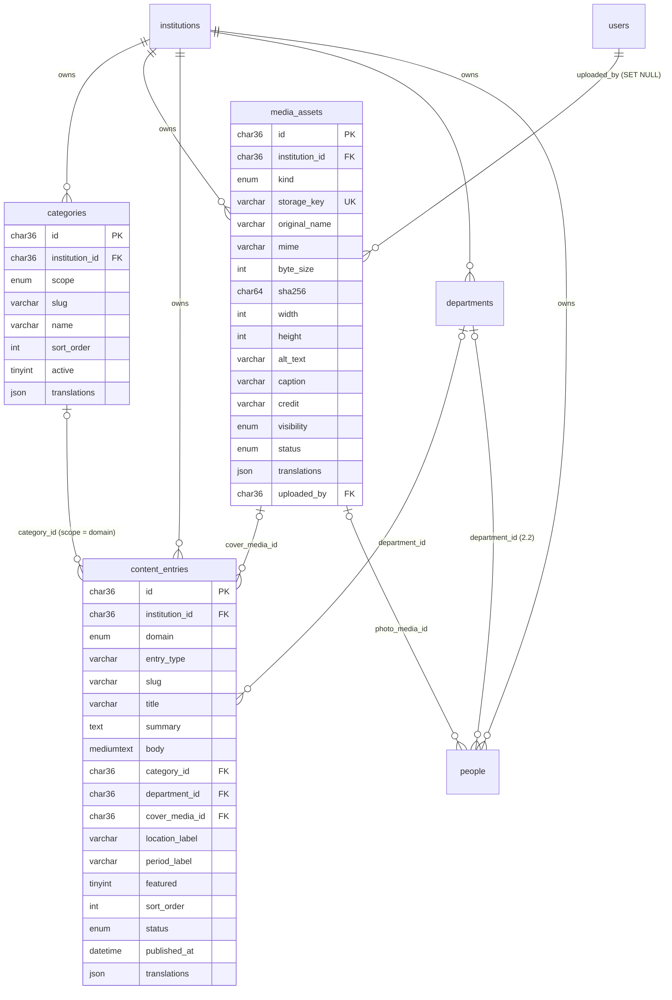

# Phase 2.3 architecture — Categories, Media Library, Culture & Heritage

| | |
| --- | --- |
| **Status** | Proposal — **awaiting architecture review**. Nothing implemented. |
| **Base commit** | `385efaa` (Phase 2.2) |
| **Parent plan** | `docs/architecture/PHASE_2_CONTENT_ARCHITECTURE.md` (this document refines its §`categories`, §`media_assets`, §`content_entries`) |
| **Findings** | `docs/audits/PHASE_2_3_ARCHITECTURE_REPORT.md` |

This is the Bureau's institutional website. Culture and Heritage are the Bureau's **documentation archive** (what the Bureau records, protects and publishes), not visitor discovery listings. No VisitHarar-style ratings, bookings, "things to do" framing or itineraries.

---

## 1. Summary of recommendations

| Topic | Recommendation |
| --- | --- |
| Categories | One `categories` table with a fixed `scope`. **One category per item** (nullable FK). `active` flag instead of status. Never hard-deleted. |
| Media | `media_assets` registry. Files stay on disk **outside the web root**, served only through PHP after a registry lookup. `visibility` = `public` or `cms_only`. Archive instead of delete. |
| Upload security | Verified type from file content (finfo **and** `getimagesize`), server-generated names, strict size and pixel limits, hardened response headers, per-user daily quota. Optional server-side re-encode (needs GD) is a decision for you. |
| Culture & Heritage | One `content_entries` table with `domain` (`culture`/`heritage`) and a code-validated `entry_type`. One cover image. Gallery deferred (purely additive later). |
| CMS | One shared editor component, mounted as two CMS sections (**Culture**, **Heritage**) with the domain fixed by route. A Media library page, a reusable media picker, and a Categories page. |
| Translations | Keep the existing `translations` JSON pattern. Add per-field fallback reporting so pages can mark English fallback text with `lang="en"`. |
| Migrations | `009_categories_media.sql` and `010_content_entries.sql` (+ rollbacks). A one-off PHP CLI backfill registers existing upload files. |
| Public | `/culture`, `/culture/:slug`, `/heritage`, `/heritage/:slug` with type/category filters, server-side search and "load more" pagination. |

Out of scope for 2.3: PDF uploads (designed below, not built), news/events/services/documents changes (2.4), freeform pages (2.5), audit log, approval workflow, new roles, identity changes.

---

## 2. Entity relationship diagram



All cross-table links use **composite foreign keys** `(institution_id, x_id) → parent(institution_id, id)` with `ON DELETE RESTRICT`, as `people → departments` does in 2.2. That makes cross-institution links impossible at the database level. (`ON DELETE SET NULL` cannot be used on these composite keys because it would also null `institution_id`.)

---

## 3. Proposed schema

### 3.1 `categories`

| Column | Type | Notes |
| --- | --- | --- |
| `id` | CHAR(36) PK | `uuid_v4()` |
| `institution_id` | CHAR(36) NOT NULL | FK → `institutions` CASCADE |
| `scope` | ENUM(`culture`,`heritage`,`news`,`events`,`documents`,`services`,`general`) NOT NULL | Fixed after create |
| `slug` | VARCHAR(255) NOT NULL | |
| `name` | VARCHAR(255) NOT NULL | English base |
| `sort_order` | INT NOT NULL DEFAULT 0 | |
| `active` | TINYINT(1) NOT NULL DEFAULT 0 | Created inactive |
| `translations` | JSON NOT NULL DEFAULT `'{}'` | `{am:{name}, om:{name}, ha:{name}}`, CHECK object |
| `created_at`, `updated_at` | DATETIME(3) | |

Keys: UNIQUE `(institution_id, scope, slug)`, UNIQUE `(institution_id, id)` (composite FK target), KEY `(institution_id, scope, active, sort_order)`.

Design decisions:

- **Scope is a column, not separate tables.** One CMS screen and one API serve all seven scopes. News/events/documents/services scopes are created now but **not wired** to those tables until 2.4.
- **Same slug in different scopes is allowed** (`culture/music` and `events/music`), because public filters are always scoped.
- **One category per item.** A second axis already exists for culture/heritage (`entry_type`), so type × category covers the realistic filtering needs. Multiple categories would need a join table, tag-style UI and many-to-many filtering; that's deferred and can be added later without breaking the single FK.
- **Lifecycle is `active` only** (no draft/published/archived). A category is vocabulary, not content.
  - **Publish gate equivalent:** editors can create and edit categories, but only admins can set `active = 1`. Editor-created categories stay inactive until an admin activates them. This reuses `ContentPolicy::canPublish`, not a new role.
  - **Deactivating while referenced is allowed.** Items keep their `category_id`; public responses omit inactive categories (`category: null`) and filters hide them. Nothing breaks and the change is reversible.
  - **No hard delete.** No DELETE route; `DELETE` deactivates. The FK `RESTRICT` blocks accidental SQL deletes of referenced rows.
- **Scope must match the content domain.** `content_entries.domain = categories.scope` is checked in PHP (a DB-level check would need a generated column in the FK, which isn't worth it).

### 3.2 `media_assets`

| Column | Type | Notes |
| --- | --- | --- |
| `id` | CHAR(36) PK | |
| `institution_id` | CHAR(36) NOT NULL | FK → `institutions` CASCADE |
| `kind` | ENUM(`image`,`document`) NOT NULL | Extend the ENUM later (`audio`, `video`) without redesign |
| `storage_key` | VARCHAR(64) NOT NULL | `{uuid}.{ext}`, server-generated. UNIQUE globally |
| `original_name` | VARCHAR(255) NULL | Sanitized, **display only**, never used for paths |
| `mime` | VARCHAR(100) NOT NULL | Server-verified type, not the browser's claim |
| `byte_size` | INT UNSIGNED NOT NULL | |
| `sha256` | CHAR(64) NOT NULL | Integrity, duplicate warning |
| `width`, `height` | INT UNSIGNED NULL | Images only, from `getimagesize` |
| `alt_text` | VARCHAR(500) NULL | English base. Required before an image can be used as a cover on published content |
| `caption` | VARCHAR(1000) NULL | |
| `credit` | VARCHAR(255) NULL | Photographer / rights holder (important for heritage archives) |
| `visibility` | ENUM(`public`,`cms_only`) NOT NULL DEFAULT `cms_only` | |
| `status` | ENUM(`active`,`archived`) NOT NULL DEFAULT `active` | |
| `translations` | JSON NOT NULL DEFAULT `'{}'` | `{am:{alt_text, caption}, …}`, CHECK object |
| `uploaded_by` | CHAR(36) NULL | FK → `users` ON DELETE SET NULL (single-column FK, so SET NULL is safe) |
| `created_at`, `updated_at` | DATETIME(3) | |

Keys: UNIQUE `(storage_key)`, UNIQUE `(institution_id, id)`, KEY `(institution_id, kind, status, created_at)`, KEY `(institution_id, sha256)`, KEY `(uploaded_by, created_at)` (quota check).

Rules:

- **Visibility is explicit.**
  - `public`: served to anyone at `/api/media/{storage_key}`.
  - `cms_only`: served only to signed-in CMS users at `/api/cms/media/{id}/file`.
  - Default is `cms_only`; the image upload flow in content editors sets `public`, matching today's behaviour.
  - Visibility is **not** derived from whether a published item uses the asset; that would need reference counting on every save.
- **Archive instead of delete.** Archived assets stop being served publicly and vanish from the picker.
  - **Archiving is blocked with 409** while published content or a published person references the asset (same rule as departments in 2.2).
  - Draft references are allowed and show a "missing image" state in the CMS.
- **No in-place replacement in 2.3.** To change an image, upload a new asset and re-point the content, so URLs stay immutable and caches stay correct. "Replace file, keep ID" is a possible later feature for documents.
- **Hard purge** (delete row + file) is deferred. When built: admin-only, only for archived and unreferenced assets, DB delete first, then file unlink.
- **Reuse:** one asset can be the cover for several entries and a person's photo. The registry is the single source; content stores only `*_media_id`.

### 3.3 `content_entries`

| Column | Type | Required | Notes |
| --- | --- | --- | --- |
| `id` | CHAR(36) PK | ✔ | |
| `institution_id` | CHAR(36) | ✔ | FK CASCADE |
| `domain` | ENUM(`culture`,`heritage`) | ✔ | **Fixed after create** (avoids changing public URLs) |
| `entry_type` | VARCHAR(32) | ✔ | Validated in PHP against the vocabulary below |
| `slug` | VARCHAR(255) | ✔ | UNIQUE `(institution_id, slug)` across both domains |
| `title` | VARCHAR(255) | ✔ | English base |
| `summary` | TEXT | | ≤ 2,000 chars, used for cards and meta description |
| `body` | MEDIUMTEXT | | ≤ 50,000 chars, plain text with paragraphs (same as other content) |
| `category_id` | CHAR(36) NULL | | Composite FK → `categories`; scope must equal domain |
| `department_id` | CHAR(36) NULL | | Composite FK → `departments` (responsible unit) |
| `cover_media_id` | CHAR(36) NULL | | Composite FK → `media_assets`; must be an active public image |
| `location_label` | VARCHAR(255) NULL | | e.g. "Harar Jugol, near Showa Gate". Mostly heritage |
| `period_label` | VARCHAR(128) NULL | | e.g. "16th century". Free text: dates in heritage are rarely exact |
| `featured` | TINYINT(1) DEFAULT 0 | | Changing it on published entries is subject to the publish gate |
| `sort_order` | INT DEFAULT 0 | | |
| `status` | ENUM(`draft`,`published`,`archived`) DEFAULT `draft` | ✔ | Existing publish gate |
| `published_at` | DATETIME(3) NULL | | Set on first publish, kept on later edits |
| `translations` | JSON NOT NULL DEFAULT `'{}'` | | `{am:{title,summary,body,location_label,period_label}, …}` |
| `created_at`, `updated_at` | DATETIME(3) | | |

Keys: UNIQUE `(institution_id, slug)`, KEY `(institution_id, domain, status, featured, sort_order, published_at)`, KEY `(institution_id, category_id)`, KEY `(institution_id, department_id)`, KEY `(institution_id, cover_media_id)`. All FKs `RESTRICT`.

**Entry type vocabulary** (a PHP constant, so changing it needs no migration; approval needed):

| Domain | `entry_type` values |
| --- | --- |
| `culture` | `tradition`, `language`, `cuisine`, `music_dance`, `clothing`, `craft`, `practice`, `documentation` |
| `heritage` | `historic_site`, `building`, `object`, `manuscript`, `documentation` |

Translated labels come from the UI catalogs (`contentTypes.culture.tradition` …), not the DB.

**Deliberately not included:** latitude/longitude (no map feature is planned; additive later), a gallery join table (`content_entry_media` is additive later), rich-text HTML (keeps XSS surface at zero), tags.

### 3.4 Change to `people` (completes the 2.2 deferral)

`ALTER TABLE people ADD photo_media_id CHAR(36) NULL` + composite FK → `media_assets` RESTRICT. The person form gets the media picker; `/organization` shows the photo with translated alt text.

---

## 4. Media security and storage design

### 4.1 Threats and controls

| Threat | Control |
| --- | --- |
| **Malicious upload / script execution** | Files are written only to `uploads_dir`, which must be **outside every web root**. Never served by the web server directly, only by `MediaController` with a fixed `Content-Type`. Allowed types exclude SVG, HTML, XML and anything scriptable. Generated `{uuid}.{ext}` names mean `shell.php.jpg`-style tricks have nothing to act on. Defence in depth: a `storage/.htaccess` with `Require all denied` plus `RemoveHandler`/`php_flag engine off` for hosts that misplace the folder. |
| **MIME spoofing** | The browser's `type` and filename are ignored. Type = `finfo(FILEINFO_MIME_TYPE)` on the temp file, must be in the allowlist, **and** for images `getimagesize()` must succeed with a matching `IMAGETYPE_*`. The current 3-byte magic fallback that accepts files finfo rejected is removed. |
| **Extension spoofing** | Stored extension comes from the verified type map, never from the client. |
| **Polyglots** (valid image header + HTML/JS payload) | Served with exact `Content-Type`, `X-Content-Type-Options: nosniff`, `Content-Security-Policy: default-src 'none'; sandbox`, `Content-Disposition: inline; filename="{storage_key}"`. A browser therefore never renders the file as a document. **Optional (decision D3):** re-encode images server-side with GD, which destroys polyglot payloads and strips EXIF (including GPS). GD is not installed in the API image today. |
| **Oversized files / decompression bombs** | Images ≤ 5 MB (unchanged) and ≤ 40 megapixels / ≤ 10,000 px per edge (checked from `getimagesize` before anything decodes the image). PHP `upload_max_filesize=8M` stays. **nginx needs `client_max_body_size 10m`** (currently defaults to 1 MB in `deploy/nginx.conf`). Later PDFs: ≤ 20 MB, raising PHP and nginx limits **only** on the upload route if possible. |
| **Disk exhaustion** | Per-user quota: ≤ 100 uploads per rolling 24 h (one `COUNT(*)` on `(uploaded_by, created_at)`). Refuse uploads when `disk_free_space(uploads_dir)` < 500 MB. No new infrastructure. |
| **Path traversal** | Public route accepts only `^[0-9a-f-]{36}\.(jpg|png|webp|gif)$`, and the key must exist in `media_assets` for the current institution. CMS file route takes a UUID `id` only. No user input ever reaches a filesystem path. |
| **Unauthorized private access** | `cms_only` assets are never served by the public route (404, not 403, to avoid confirming existence). The CMS route requires a session (viewer+) and sends `Cache-Control: private, no-store`. |
| **Cross-institution access** | Every lookup includes `institution_id = Db::institutionId()`. Composite FKs stop content from referencing another institution's asset. Files stay in one flat folder; isolation is enforced by the registry, not by directory layout. |
| **Unsafe filenames** | `original_name` is stripped of path components, control characters and bidi overrides, normalised and truncated to 255. It's shown escaped in the CMS and never used to build a path or a `Content-Disposition` header. |
| **Draft / archived exposure** | Archived assets are not served. Caching drops from `immutable, 1 year` to `public, max-age=86400`, so un-publishing or archiving takes effect within a day even through caches. |
| **CSRF / role abuse** | Unchanged: double-submit CSRF on all mutations, editor+ to upload or edit, admin to activate categories and publish. |

### 4.2 Where files live

- **Docker / VPS:** keep `backend/storage/uploads/`. It's already outside `backend/public/` (the PHP document root), and `router.php` only serves files under `public/`, so this layout is correct.
- **Shared hosting:** `docs/FULL_MIGRATION_MAP.md` currently suggests `public_html/storage/`, which **is web-accessible**. Change the deploy guidance to put `storage/` (and `app/`, `config/`) **above** `public_html` and point `config.php → uploads_dir` there. If the host can't do that, the shipped deny-all `.htaccess` is the fallback. This is a documentation change plus one `.htaccess` file, no code.
- No per-visibility directories: a file doesn't move when its visibility changes; the controller decides.

### 4.3 Upload pipeline (images, 2.3)

1. `ContentPolicy::requireEditor()`; CSRF already enforced by the front controller.
2. Quota and free-disk checks.
3. `is_uploaded_file`, size ≤ 5 MB.
4. finfo type ∈ {`image/jpeg`, `image/png`, `image/webp`, `image/gif`}, plus `getimagesize` ok with a matching type, plus pixel limits.
5. Optional GD re-encode (decision D3).
6. `sha256_file`; `storage_key = uuid.ext`; `move_uploaded_file`; `chmod 0640`.
7. Insert the `media_assets` row. **If the insert fails, unlink the file** (no orphans).
8. Return the asset JSON (`id`, `url`, `width`, `height`, …).

`POST /api/cms/media` keeps returning `url` and `name` for the existing `ImageField` (news/services covers) and adds `id`, so legacy callers don't break.

### 4.4 Future PDFs (designed, not built in 2.3)

- **Accepted type:** finfo `application/pdf` **and** a `%PDF-` header, ≤ 20 MB, `kind = document`.
- **Visibility:** default `cms_only`.
- **Public download:** `Content-Disposition: attachment` by default, with an option for inline viewing under the same `CSP sandbox`.
- **No server-side PDF parsing.** Malware scanning (ClamAV) depends on the host and is a hosting decision.
- **Office formats (docx/xlsx)** would need ZIP container checks. Exclude them until there's a real need.

---

## 5. API contracts

Conventions follow existing code:
- JSON throughout; lists are `{items}`.
- `?lang=en|am|om|ha`.
- Errors use `json_error(status, code, message)`.
- CMS lists include all statuses.
- `DELETE` archives (or deactivates) rather than deleting.

### 5.1 Public

| Method | Path | Notes |
| --- | --- | --- |
| GET | `/api/categories?scope=culture&lang=` | Active only, ordered `sort_order, name`. `scope` required. Returns `{slug, name, language, usedFallback}` |
| GET | `/api/culture?lang=&type=&category=&q=&featured=1&limit=24&offset=0` | Published only |
| GET | `/api/culture/{slug}?lang=` | Published only; 404 otherwise (including if the slug is a heritage entry) |
| GET | `/api/heritage…` | Same contract with `domain = heritage` |
| GET | `/api/media/{storage_key}` | **Changed behaviour:** requires a registry row that is `public` + `active` for this institution |

List response (adds `total`, `limit`, `offset`; still `items` so existing client patterns work):

```json
{
  "items": [
    {
      "slug": "…", "domain": "heritage", "entryType": "building",
      "title": "…", "summary": "…", "locationLabel": "…", "periodLabel": "…",
      "featured": true, "publishedAt": "2026-…Z",
      "category": { "slug": "…", "name": "…" },
      "cover": { "url": "/api/media/….jpg", "alt": "…", "width": 1600, "height": 1067 },
      "language": "am", "usedFallback": true, "fallbackFields": ["summary"]
    }
  ],
  "total": 37, "limit": 24, "offset": 0
}
```

Detail adds `body`, `department {slug,name}` (only if published, as in 2.2), and `cover.caption` / `cover.credit`. Never exposed publicly: `id`, `status`, `institution_id`, raw `translations`, `uploaded_by`, `original_name`, `sha256`.

Filtering and validation:
- `type` must be in the domain's vocabulary (otherwise 400).
- `category` is a category slug within the domain scope; unknown or inactive slugs return an empty list, not an error.
- `limit` ≤ 50, `offset` ≤ 10,000.
- `q` is 2–100 chars. It does a `LIKE` on base `title`/`summary` and on the requested language's translated title/summary (`JSON_VALUE`), with `%`/`_` escaped. A FULLTEXT index is deferred until volume justifies it.
- Order: `featured DESC, sort_order ASC, published_at DESC`.

### 5.2 CMS

| Method | Path | Role |
| --- | --- | --- |
| GET | `/api/cms/categories?scope=` | viewer+ |
| GET | `/api/cms/categories/{id}` | viewer+ |
| POST | `/api/cms/categories` | editor+ (`active` forced to 0 unless admin) |
| PUT | `/api/cms/categories/{id}` | editor+ (only admin may change `active`); `scope` immutable |
| DELETE | `/api/cms/categories/{id}` | admin — deactivates |
| GET | `/api/cms/media?kind=&status=&visibility=&q=&limit=&offset=` | viewer+ |
| GET | `/api/cms/media/{id}` | viewer+ (includes `usage`: list of referencing entries/people) |
| GET | `/api/cms/media/{id}/file` | viewer+, streams any active or archived asset, `private, no-store` |
| POST | `/api/cms/media` | editor+ (multipart: `file`, optional `visibility`, `altText`) |
| PUT | `/api/cms/media/{id}` | editor+ — metadata only (alt, caption, credit, translations, visibility) |
| DELETE | `/api/cms/media/{id}` | editor+ — archive; 409 if referenced by published content |
| GET | `/api/cms/content-entries?domain=&type=&status=&category=&q=&limit=&offset=` | viewer+ |
| GET | `/api/cms/content-entries/{id}` | viewer+ |
| POST | `/api/cms/content-entries` | editor+, publish gate |
| PUT | `/api/cms/content-entries/{id}` | editor+, publish gate; `domain` immutable |
| DELETE | `/api/cms/content-entries/{id}` | editor+ — archive |

Media rules beyond the table:
- Switching a published content item's cover asset to `cms_only` is a 409 while the reference exists.
- Editors may change asset visibility from `cms_only` to `public` only if the asset isn't yet referenced by published content. Admins always can.

Server-side validation for content entries:
- `entry_type` must be in the vocabulary for the domain.
- The category must exist in this institution, be in the same scope, and be active (an unchanged existing link is allowed, as in 2.2).
- The department must exist and not be archived.
- The cover must be an active, public image, and **must have alt text before the entry can be published**. Admins publishing an entry whose cover lacks alt text get a 400 with a clear message.
- Text goes through `plain_text()` with limits; translations go through `normalize_translations()`.

---

## 6. CMS workflows

**Navigation:** a new "Heritage & culture" group in `CmsLayout` with **Culture**, **Heritage**, **Media library** and **Categories**.

**Culture / Heritage (one component, two mounts):** `/cms/culture`, `/cms/culture/new`, `/cms/culture/:id`, and the same for heritage. The route fixes the domain, so editors never pick it and the type list and category list are already scoped. One shared component is less code than two near-identical editors, and two menu entries match how the Bureau thinks about its work. The alternative (one "Content" screen with a domain filter) saves a nav item but makes every form show a domain switch that can't be changed after create.

**Edit form** sections:
- **Details:** title, slug (auto), type, category, department, location, period, featured, display order, status.
- **Summary and body.**
- **Cover:** media picker, showing the chosen image's alt text with a warning if it's missing.
- **Translations:** am/om/ha for title, summary, body, location and period.

It reuses `cms-page-form`, `cms-fieldset`, the dirty guard, read-only mode for viewers and the archive confirmation from `OrganizationPages.tsx`.

**Typical flow:**
1. An editor uploads a photo in the picker and enters alt text and credit.
2. The editor writes the entry and saves. It becomes a draft (publish gate).
3. An admin reviews, adds or checks translations, and publishes.

**Media library** (`/cms/media`):
- A grid of thumbnails with filters (kind, visibility, status) and a search on name or alt text.
- An upload button.
- A detail drawer with the preview, metadata and translations, a "Used by" list and Archive. Archive is disabled with an explanation when the asset is used by published content.

**Media picker:** a dialog reused by the content editor and the person form. It shows the library filtered to active public images, offers "Upload new" inline, and returns an asset id. The existing `ImageField` (URL-based) stays for news and services until 2.4.

**Categories** (`/cms/categories`): a scope selector (tabs), a list ordered by display order, and an inline create/edit form with name, slug, order and translations. The Active toggle is shown only to admins; editors see "Inactive — an administrator must activate".

---

## 7. Multilingual approach

- **Base language: English.** Base columns hold English; `translations` holds `am`, `om` and `ha` objects. Same as pages, departments and people.
- **Translatable fields:**

  | Table | Fields |
  | --- | --- |
  | `categories` | `name` |
  | `media_assets` | `alt_text`, `caption` |
  | `content_entries` | `title`, `summary`, `body`, `location_label`, `period_label` |

  `credit`, names and slugs are not translated.
- **Fallback:**
  - Per field: an empty translation falls back to English.
  - Each item reports `language`, `usedFallback` (as in 2.2), and the new `fallbackFields: [...]`. This is a small extension of the existing `resolve_translations()` helper.
  - The frontend wraps fallback fields in `lang="en"` so screen readers pronounce them correctly, and shows the existing notice ("Some details are shown in English …").
- **Alt text:**
  - The cover object's `alt` is resolved in the requested language, falling back to English.
  - Decorative images aren't a use case for covers; empty alt is not allowed for published covers.
  - The existing `CoverMedia alt=""` usage in news and services is a known accessibility gap, fixed in 2.4 when those tables get `cover_media_id`.
- **UI language vs content language:**
  - The UI language (cookie `lang`, `messages/*.json`) controls labels and is passed to the API as `?lang=`.
  - The content language is what the API actually returned, per field.
  - The two can differ; the page never claims a translation exists when it fell back.
- **Catalog honesty:** new UI keys go into all four catalogs. `ha` currently holds English text for many keys and still needs native review; this plan doesn't change that.

---

## 8. Public routes

| Route | Content |
| --- | --- |
| `/culture` | Intro (Bureau's role in documenting culture), featured entries, filter by type and category, search, card grid, "Load more" |
| `/culture/:slug` | Cover (with caption and credit), title, type, category, period, location, responsible department, body, "More in this category" (up to 3, same API with `category=`) |
| `/heritage`, `/heritage/:slug` | Same templates with heritage copy |

- **Placement:** added to `App.tsx` before the `/:slug` catch-all. There are no existing page slugs `culture`/`heritage` (checked in the local DB, and `GUIDE_SLUGS` doesn't use them). `PagesController` should reserve both slugs so a future freeform page can't shadow them.
- **Filters:** state lives in the URL (`?type=&category=&q=`) using `useSearchParams`, like `ResourcesListPage`. Filters use buttons with counts only when they're cheap; otherwise no counts.
- **Search:** server-side `q`, debounced. Empty results show a "No entries match" message with a reset button.
- **Featured:** the first row shows featured entries; nothing is shown if none are featured.
- **Images:** the existing `CoverMedia` component (`thumb` / `hero` ratios), `loading="lazy"` on cards, width/height from the registry to prevent layout shift, and caption and credit on the detail page.
- **Empty states:** the `CatalogState` pattern from `/organization`: "The Bureau will publish verified culture/heritage documentation here" plus a contact link. **No placeholder entries are seeded.**
- **SEO:** `usePageHead` with the entry title and summary as description. `usePageHead` currently has no image parameter; add an optional `image` for `og:image`. Detail pages use a canonical `/culture/{slug}`. Because this is an SPA, meta is client-side (a known limitation shared by all routes).
- **Sitemap:** add `/culture` and `/heritage` plus published entries under the matching prefix.
- **Responsive:** reuse the `news-listing` card grid and the 800px layout breakpoint. Filters collapse into a horizontally scrollable chip row on small screens.
- **Navigation:** decision D6 (below). Recommended: in 2.3, link Culture and Heritage from the footer and the About page only. The primary-nav restructure (grouping under "Culture & Heritage") stays in 2.7, because the header already needed a 1100px collapse at seven items.

---

## 9. Migration plan

Current numbering ends at `008`. Proposed files:

| File | Creates / changes |
| --- | --- |
| `009_categories_media.sql` | `categories`, `media_assets`, `ALTER people ADD photo_media_id` + FK |
| `009_categories_media.rollback.sql` | Drop FK + `people.photo_media_id`, drop `media_assets`, drop `categories` |
| `010_content_entries.sql` | `content_entries` |
| `010_content_entries.rollback.sql` | Drop `content_entries` |
| `backend/bin/backfill-media.php` | CLI, idempotent: registers every file in `uploads_dir` that has no row as `kind=image`, `visibility=public`, `status=active`, with dimensions and sha256 computed. Non-image or unreadable files are reported and **left unregistered** (so they're no longer served) |

- **Ordering:** `007 → 008 → 009 → backfill → 010`. Run the backfill **before** deploying the new `MediaController`; otherwise existing cover images (news/services `cover_image = '/api/media/…'`) return 404 until it runs.
- **Safe defaults:**
  - `categories.active = 0` and `media_assets.visibility = 'cms_only'`.
  - `content_entries.status = 'draft'`.
  - `translations` defaults to `'{}'`.
  - New `people.photo_media_id` is NULL.
- **Idempotency:** `CREATE TABLE IF NOT EXISTS`. MariaDB supports `ADD COLUMN IF NOT EXISTS` and `ADD CONSTRAINT … FOREIGN KEY IF NOT EXISTS` for the `people` change. Tested with re-apply, like the 008 test.
- **Existing data:**
  - No existing rows are modified.
  - News/services `cover_image` and documents `file_url` stay as text until 2.4.
  - Free-text `category` columns stay. The local DB shows VisitHarar-era values ("Mosques & Shrines", "Experience · …"), which must **not** be auto-converted into Bureau categories.
- **Rollback limitations:**
  - Rollback deletes all category, media-registry and entry data.
  - It does **not** delete uploaded files (they become unregistered, and are then served only by the old controller after a code rollback).
  - Take a DB backup first.
  - Roll back 010 before 009.
- **Fresh databases:** Docker init loads only `001` and `002_seed_placeholder`. Apply 007–010 manually in order, as in 2.1/2.2.
- **Manual-migration risk:** with ten numbered files and no record of what has been applied, drift between environments is likely. Decision D8 proposes a minimal `schema_migrations` table and an apply script; it's not needed to ship 2.3.
- **Tests (same style as 2.2):**
  - `scripts/test-migration-009-010.sh` on a disposable DB: constraints, cross-institution rejection, RESTRICT, rollback.
  - `scripts/smoke-content-media.py`: upload validation (spoofed extension, HTML renamed `.jpg`, oversize, pixel bomb header, SVG), private-asset 404, cross-institution 404, publish gate, scope mismatch, fallback.

---

## 10. Risks and mitigations

| Risk | Mitigation |
| --- | --- |
| Existing covers break after the registry-required serving change | Backfill script plus deploy order; smoke test checks existing `/api/media/*` URLs still return 200 |
| Shared-host deploy exposes `storage/` | Corrected deploy guidance plus deny-all `.htaccess`; pre-launch checklist item: request `/storage/uploads/{key}` directly and expect 403/404 |
| Polyglot images without GD | Strict response headers neutralise browser execution; GD re-encode (D3) removes the payload entirely |
| EXIF GPS in heritage photos reveals sensitive site locations | Client already re-encodes via canvas in the CMS (strips EXIF), but that's not enforced server-side; D3 closes it |
| Editors publish via category activation or visibility | `active` and public-switch on referenced assets are admin-gated |
| Entry-type vocabulary churn | Kept in a PHP constant plus catalogs; no migration to change |
| Scope creep (gallery, tags, maps, rich text) | Explicitly deferred; all are additive |
| Translation quality (`ha`) | Fallback is visible and honest; native review stays a tracked item |
| Large lists without pagination elsewhere | New endpoints paginate; existing endpoints unchanged |
| nginx 1 MB body limit breaks uploads behind the `web` profile | Set `client_max_body_size 10m` in `deploy/nginx.conf` as part of 2.3 |

---

## 11. Decisions requiring approval

| # | Decision | Recommendation |
| --- | --- | --- |
| D1 | One category per item vs many | **One** (nullable FK); join table later if needed |
| D2 | Editors create categories inactive; only admins activate | **Yes** |
| D3 | Add the GD extension to the API image for server-side re-encode (strips EXIF/GPS and polyglot payloads). Shared hosts usually have GD | **Yes**, with a fallback to strict headers only if GD is missing |
| D4 | Media visibility explicit (`public`/`cms_only`) rather than derived from published references | **Explicit** |
| D5 | Gallery (`content_entry_media`) in 2.3 or later | **Later** (additive) |
| D6 | Navigation: footer/About links in 2.3, primary nav in 2.7 | **Yes** |
| D7 | Entry-type vocabulary (§3.3) | Bureau to confirm or adjust |
| D8 | Add a `schema_migrations` table and apply script | Separate small slice, not in 2.3 |
| D9 | `domain` immutable after create | **Yes** |
| D10 | Require alt text on covers of published entries | **Yes** |
| D11 | Public media cache: 1 day instead of 1 year immutable | **Yes** |
| D12 | Upload quota (100/user/day) and 500 MB free-disk floor | **Yes**, values adjustable in config |
| D13 | Shared-host layout: storage/app/config above `public_html` | **Yes** — doc fix in 2.3 |
