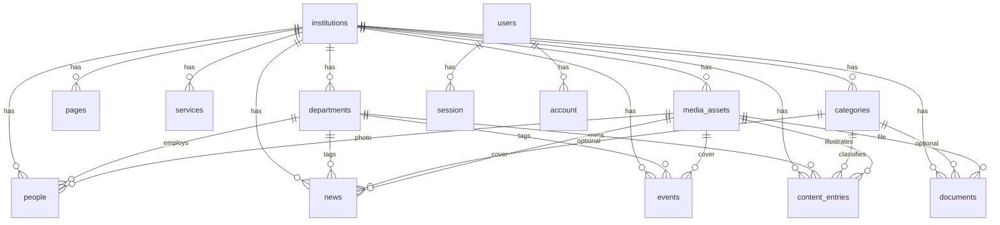

# Phase 2 — Institutional Content Architecture & Database Design

| Field | Value |
| --- | --- |
| **Project** | Harari Culture, Heritage & Tourism Bureau — official institutional website |
| **Repository** | https://github.com/Hamdiabdosh/culture-heritage-tourism-bureau |
| **Date** | 21 November 2026 |
| **Status** | Planning approved; Phase 2.1 committed (`c595921`); **Phase 2.2 implemented locally (awaiting review/commit)** |
| **Planning commit** | `e51990f945f9d943bf6077babab95b313ec28c7d` |
| **Depends on** | Phase 0 audit, Phase 1 identity (`7a36129`), Roadmap V1 |

### Approved architecture decisions (2026-11-21)

| Topic | Decision |
| --- | --- |
| Culture and Heritage | Shared `content_entries` table |
| About content | Structured institution profile fields **plus** CMS pages |
| News route | Introduce `/news`; preserve `/stories` compatibility |
| Publications route | Keep `/resources` |
| PDF binary upload | Defer until secure file storage is designed |
| Institution identity transition | Only after verified official content and backup |
| Legacy tourism records | Preserve and classify; never blindly delete |
| Freeform pages | Review and unlock in a **separate** implementation slice |

---

## 1. Current architecture findings

Verified against source (not docs alone).

### Live stack

| Layer | Reality |
| --- | --- |
| Frontend | Vite + React 19 + React Router 7 (`frontend/`) |
| Backend | PHP PDO JSON API (`backend/public/index.php`, `routes/api.php`) |
| DB | MariaDB/MySQL; base `001_schema.sql` + manual `003`–`007` SQL |
| Auth | Cookie session + CSRF + roles `admin` / `editor` / `viewer` |
| i18n UI | `messages/{en,am,om,ha}.json` |
| Content i18n | **`pages.translations` JSON only**; news/events/services/documents are single-language fields |

### Existing tables

`institutions`, `users`, `account`, `session`, `pages`, `news`, `services`, `events`, `documents`  
(+ runtime `cover_image` on `news`/`services` via `003_cover_image.sql`)

### Existing CMS / API (reusable)

| Domain | Public API | CMS | Notes |
| --- | --- | --- | --- |
| Institution profile (contact/name) | `GET /institution` | `PUT /cms/institution` | No mission/vision/history fields |
| Pages | `GET /pages`, `GET /pages/{slug}?lang=` | CRUD but **create forbidden**; fixed slugs `plan`, `plan-itineraries` | VisitHarar guide-slot policy |
| News | `/news` | Full CRUD + publish gate | Public UI at `/stories` |
| Events | `/events` | Full CRUD | Free-text `type` |
| Services | `/services` | Full CRUD | Used as attractions/experiences via category heuristic |
| Documents | `/documents` | Metadata CRUD; `file_url` string | Allowlist URL helper; **no binary PDF upload pipeline** |
| Media | `/media/{file}` | `POST /cms/media` images only | UUID files under `storage/uploads` |

### Migration process today

- **No migration runner.** Numbered SQL files; Docker init applies `001` + placeholder seed only.
- `003+` must be applied manually — drift risk on fresh environments.
- `002_seed_dev.sql` is **gitignored** (local hashes).

### Phase 1 public IA (current)

Primary nav: Home, About, News (`/stories`), Events, Publications (`/resources`), Contact.  
Culture & Heritage and Public Services **intentionally omitted** until this architecture lands.

---

## 2. Proposed institutional content domains

Design principle: **reuse what works; add tables only for missing institutional concepts; do not invent Bureau facts.**

| Domain | Strategy |
| --- | --- |
| **A. Institutional profile** | **Extend** `institutions` (+ optional structured JSON) and unlock/use `pages` for long-form About sections |
| **B. Leadership & organization** | **New** `departments` + `people` (leadership) |
| **C. Culture** | **New** shared archive entity `content_entries` with `domain='culture'` |
| **D. Heritage** | Same `content_entries` with `domain='heritage'` |
| **E. News & announcements** | **Extend** `news` (kind, featured, department, translations) |
| **F. Events** | **Extend** `events` (kind, end date, cover, department, translations) |
| **G. Publications** | **Extend** `documents` + introduce secure file registry |
| **H. Public services** | **Extend** `services` with `kind` discriminator; retire tourism heuristic for public Bureau UX |

Legacy VisitHarar attraction/experience rows remain in `services` until content ops reclassify or archive — **never delete blindly**.

---

## 3. Entity relationship model

### Mermaid ER (proposed)

### Entity catalogue

#### `institutions` (extend — existing)

| Aspect | Proposal |
| --- | --- |
| Purpose | Single Bureau tenant identity + contact |
| Important new fields | `mission` TEXT NULL, `vision` TEXT NULL, `history` MEDIUMTEXT NULL, `values_json` JSON NULL, `objectives_json` JSON NULL, `profile_translations` JSON NULL (am/om/ha mirrors of narrative fields) |
| PK | `id` CHAR(36) |
| Relationships | Parent of all content |
| Translations | `profile_translations` for narrative fields; name/short_name remain base (EN) with optional translation map later |
| Publishing | Always “live” contact; narrative fields editable by editor+ |
| CMS | Extend Site settings form |

**Controlled identity transition:** Editors update `name` / `short_name` / `eyebrow` / narrative fields via CMS after Bureau verification — **no destructive seed overwrite**. Keep old VisitHarar values recoverable via DB backup / prior row snapshot before change (ops checklist).

#### `departments` (new)

| Aspect | Proposal |
| --- | --- |
| Purpose | Directorates/units (Culture, Heritage, Language, etc.) — structure only; **names filled by Bureau** |
| Fields | `id`, `institution_id`, `slug`, `name`, `summary`, `description`, `sort_order`, `status`, `translations` JSON, timestamps |
| PK | `id` |
| Relationships | Optional FK from people, news, events, content_entries |
| Translations | JSON `{am,om,ha:{name,summary,description}}` (same pattern as pages) |
| Publishing | draft/published/archived |
| CMS | List/create/edit under Organization |

#### `people` (new — leadership profiles)

| Aspect | Proposal |
| --- | --- |
| Purpose | Leadership & key staff profiles **without hardcoding names in code** |
| Fields | `id`, `institution_id`, `department_id` NULL, `slug`, `full_name`, `title`, `bio`, `photo_media_id` NULL, `email` NULL, `phone` NULL, `sort_order`, `is_leadership` TINYINT, `status`, `translations` JSON, timestamps |
| PK | `id` |
| Relationships | → departments, → media_assets |
| Translations | title/bio |
| Publishing | draft/published/archived |
| CMS | Leadership manager |

**Do not seed invented people.** Empty table until Bureau supplies verified data.

**As implemented in 2.2 (differs from the proposal above):**

- `photo_media_id` is **not** created yet. It is added with `media_assets` in 2.3; no interim `photo_url` column, to avoid a second migration path.
- `people.department_id` uses a composite FK `(institution_id, department_id) → departments(institution_id, id)` `ON DELETE RESTRICT`, so a person cannot point at another institution's department.
- `DELETE` on both resources is a soft archive. Archiving a department returns **409** while non-archived people still reference it; new links to an archived department are rejected (400).
- Public responses expose a person's department only when that department is published.
- `full_name` is not translated; `title` and `bio` are. Department `name`/`summary`/`description` are translated.
- `/organization` is a single page (open decision 3 resolved). Detail endpoints exist for future use; no nested public routes.
- The Organization nav link ships with 2.2 (moved forward from 2.7).

#### `content_entries` (new — Culture & Heritage archive)

| Aspect | Proposal |
| --- | --- |
| Purpose | One flexible archive for culture practices **and** heritage sites/items |
| Fields | `id`, `institution_id`, `domain` ENUM(`culture`,`heritage`), `entry_type` VARCHAR (e.g. tradition, cuisine, music, site, building, documentation, initiative), `category_id` NULL, `department_id` NULL, `slug`, `title`, `summary`, `body`, `cover_media_id` NULL, `location` NULL, `year_label` NULL, `status`, `published_at`, `translations` JSON, timestamps |
| PK | `id` |
| Relationships | categories, departments, media |
| Translations | title/summary/body |
| Publishing | draft/published/archived + publish gate |
| CMS | Culture / Heritage modules filtered by `domain` |

Avoid separate tables per tradition/clothing/music unless volume later requires it — use `entry_type` + categories.

#### `categories` (new)

| Aspect | Proposal |
| --- | --- |
| Purpose | Controlled vocabularies per scope |
| Fields | `id`, `institution_id`, `scope` ENUM(`culture`,`heritage`,`news`,`events`,`documents`,`services`,`general`), `slug`, `name`, `translations` JSON, `sort_order`, `active` |
| Unique | `(institution_id, scope, slug)` |

Free-text `category` columns on news/events/documents/services remain for backward compatibility; new writes prefer `category_id` when present.

#### `media_assets` (new — registry)

| Aspect | Proposal |
| --- | --- |
| Purpose | First-class media/document files (images now; PDFs later) |
| Fields | `id`, `institution_id`, `stored_name`, `original_name`, `mime`, `byte_size`, `kind` ENUM(`image`,`document`,`other`), `visibility` ENUM(`public`,`cms_only`), `uploaded_by` NULL, `created_at` |
| Storage | Continue filesystem under `storage/uploads` (or `storage/files`); DB holds metadata |
| Security | Reuse MIME/size checks; extend allowlist for PDF in Phase 2b/4 |

Existing `/api/media/{uuid}.ext` can resolve via registry or remain path-compatible.

#### Extend `news`

Add: `kind` ENUM(`news`,`announcement`,`press_release`,`update`) DEFAULT `news`, `featured` TINYINT, `department_id` NULL, `category_id` NULL, `translations` JSON, (keep `cover_image` or migrate to `cover_media_id`).

#### Extend `events`

Add: `kind` VARCHAR/ENUM (cultural, institutional, festival, workshop, conference), `ends_at` DATETIME NULL, `cover_media_id` NULL, `department_id` NULL, `translations` JSON.

#### Extend `documents`

Add: `kind` (report, research, policy, annual_report, cultural_doc, other), `language_code` CHAR(5) NULL (document language), `media_asset_id` NULL (preferred over raw URL), `translations` JSON for title/summary, `is_public` TINYINT DEFAULT 1.  
Keep `file_url` for legacy rows.

#### Extend `services`

Add: `kind` ENUM(`bureau_service`,`legacy_attraction`,`legacy_experience`) DEFAULT `bureau_service`, `department_id` NULL, `translations` JSON.  
Public `/services` lists `bureau_service` only. Legacy kinds remain in DB for CMS cleanup; visitor routes can stay hidden from primary nav.

#### `pages` policy change (implementation phase)

- Allow freeform page create again for institutional pages (history, mandate, etc.) **or** rely on extended `institutions` fields + few fixed slugs (`about`, `mandate`).
- Retire VisitHarar-only `GUIDE_SLUGS` create-block; archive `plan` / `plan-itineraries` pages rather than deleting.

---

## 4. Proposed database schema (additive)

Suggested new numbered SQL (implementation later — **do not apply in this planning task**):

| File | Purpose |
| --- | --- |
| `007_institution_profile_fields.sql` | ALTER institutions add mission/vision/history/values/objectives/profile_translations |
| `008_org_structure.sql` | CREATE departments, people |
| `009_categories_media.sql` | CREATE categories, media_assets |
| `010_content_entries.sql` | CREATE content_entries + indexes |
| `011_extend_news_events_docs_services.sql` | ALTER add kind/featured/department/translations/media FKs |
| `012_pages_policy_note.md` or code change | Document unlock of page create (code, not SQL) |

### Indexes (illustrative)

- `content_entries (institution_id, domain, status, published_at)`
- `content_entries (institution_id, slug)` UNIQUE
- `people (institution_id, is_leadership, sort_order)`
- `departments (institution_id, slug)` UNIQUE
- `media_assets (institution_id, stored_name)` UNIQUE

### Integrity rules

- All content scoped by `institution_id` = configured Bureau id.
- Publishing gate unchanged: editors cannot set `published` (existing `ContentPolicy`).
- Soft archive via `status='archived'` — **no DELETE of production rows** in migrations.
- FK `ON DELETE RESTRICT` for departments referenced by published content; soft-deactivate departments instead.

### Rollback

- Each `007+` file should be pairable with a `007_rollback.sql` that drops **only new** tables/columns (never drop `news`/`users`/etc.).
- Column adds are nullable with defaults — safe rollback if unused.
- Institution field updates are data ops with backup, not schema rollback.

---

## 5. Multilingual strategy

| Layer | Current | Phase 2–3 target |
| --- | --- | --- |
| UI chrome | `messages/*.json` | Keep; Phase 3 deepens OM/HA |
| Pages | `translations` JSON + `?lang=` resolve | Keep pattern as **canonical** |
| News/events/docs/services | None | Add `translations` JSON + resolve like pages |
| New entities | — | Same JSON pattern for V1 speed; normalize later if needed |
| Fallback | Pages: base EN title/content | All entities: request lang → translation → EN base; expose `usedFallback` |
| RTL | Not required for Ethiopic/Latin | Monitor; no forced `dir=rtl` |
| Completeness | UI incomplete for ha/om | CMS shows per-locale completeness meters (pages already have UX hooks) |

**Phase boundary:** Schema + API hooks for translations can land in Phase 2 implementation; full editorial translation workflows and catalog completeness are Phase 3.

---

## 6. CMS management requirements

| Module | List/filter | Create/edit | Publish | Media | Translations | Notes |
| --- | --- | --- | --- | --- | --- | --- |
| Institution profile | — | Settings form + narrative fields | n/a | logo later | profile_translations | Controlled identity update |
| Departments | Yes | Yes | Yes | — | Yes | Sort order |
| Leadership | Yes | Yes | Yes | Photo | Yes | Empty until verified data |
| Culture entries | Filter domain=culture | Yes | Yes | Cover | Yes | entry_type taxonomy |
| Heritage entries | Filter domain=heritage | Yes | Yes | Cover | Yes | Same table |
| News | Extend filters by kind | Existing | Existing gate | Cover | Add | Featured flag |
| Events | By kind/date | Existing | Existing | Cover | Add | ends_at |
| Publications | By kind/year | Existing + file upload | Existing | Document asset | Add | Replace raw URL over time |
| Services | Filter kind=bureau_service | Existing | Existing | — | Add | Hide legacy kinds in public |

Permissions: keep server-side `ContentPolicy` (no new RBAC in Phase 2). Governance (approver/audit) = Phase 4.

---

## 7. API requirements

### Extend existing

| Endpoint family | Changes |
| --- | --- |
| `/institution` | Return new profile fields |
| `/cms/institution` | Accept new fields |
| `/news`, `/cms/news` | kind, featured, departmentId, translations, lang resolve on public |
| `/events`, `/cms/events` | kind, endsAt, translations, cover |
| `/documents`, `/cms/documents` | kind, mediaAssetId, translations; optional file upload endpoint |
| `/services`, `/cms/services` | kind filter; public lists bureau_service only |
| `/pages`, `/cms/pages` | Re-enable create; drop VisitHarar-only create block |

### New endpoint families

| Resource | Public | CMS |
| --- | --- | --- |
| Departments | `GET /departments`, `GET /departments/{slug}` | `/cms/departments` CRUD |
| People | `GET /leadership`, `GET /people/{slug}` | `/cms/people` CRUD |
| Content entries | `GET /culture`, `GET /heritage` (+ `/{slug}`) or `GET /content?domain=` | `/cms/content-entries` |
| Categories | `GET /categories?scope=` | `/cms/categories` |
| Media registry | existing show | `POST /cms/media` (+ document upload variant) |

Sitemap: include new public slugs; fix path drift (`/stories` vs `/news`) when touching `SitemapController`.

---

## 8. Public website routes

Recommended IA (aligns with content model; Visit Harar stays separate):

| Nav label | Route | Source |
| --- | --- | --- |
| Home | `/` | Existing |
| About the Bureau | `/about` | Institution profile + optional pages |
| Organization | `/organization` | departments + leadership |
| Culture | `/culture`, `/culture/:slug` | content_entries domain=culture |
| Heritage | `/heritage`, `/heritage/:slug` | content_entries domain=heritage |
| News & announcements | `/news` (prefer) or keep `/stories` + redirect | news |
| Events | `/events`, `/events/:slug` | events |
| Publications | `/resources` or rename `/publications` | documents |
| Public services | `/services`, `/services/:slug` | services kind=bureau_service |
| Contact | `/contact` | institution contact |

**Compatibility:** Keep redirects from `/stories` → `/news` if renaming; keep legacy `/explore` offline from nav.

---

## 9. Migration strategy

1. Backup DB volume before any ALTER.
2. Apply additive `007`–`011` in order on staging first.
3. Deploy API that tolerates missing new columns? Prefer **migrate then deploy** in one window.
4. CMS: ship institution profile fields; leave org/culture empty.
5. **Institution identity data change:** editor updates via UI after written Bureau approval; capture before/after screenshot + SQL dump of `institutions` row.
6. Reclassify services: set `kind=legacy_attraction|legacy_experience` for existing tourism rows via one-time UPDATE (non-destructive).
7. Unlock pages create in code; archive plan guide pages with status=archived.
8. Do **not** truncate VisitHarar news/events/docs.

Compatibility: old frontend continues if new columns nullable; new frontend features gate on API presence.

---

## 10. Security considerations

| Topic | Requirement |
| --- | --- |
| Uploads | Keep MIME/size/magic-byte checks; PDF allowlist separate; store outside web root |
| Documents | Prefer `media_assets` + authenticated upload; validate URL allowlist for legacy `file_url` |
| Access | Public GETs published only; CMS requires session + role |
| Private docs | `is_public=0` / `visibility=cms_only` — do not serve on public routes |
| Input | Existing JSON validation patterns; sanitize HTML if rich text introduced |
| Integrity | institution_id scoping on every query |
| Auditability | Defer append-only audit log to Phase 4; until then rely on DB backups + publish gate |

---

## 11. Implementation sequence (approved)

| Step | Work | Depends |
| --- | --- | --- |
| **2.1** | SQL `007` institution profile fields + API/CMS settings + About integration | Approval ✓ |
| **2.2** | SQL `008` departments + people + APIs/CMS + `/organization` (implemented, awaiting review) | 2.1 ✓ |
| 2.3 | SQL `009`–`010` categories, media_assets, content_entries + culture/heritage routes | 2.2 |
| 2.4 | SQL `011` extend news/events/documents/services + public filters; add `/news` with `/stories` redirect | 2.1 |
| 2.5 | Freeform pages unlock (separate slice) — archive VisitHarar guide pages | After 2.1 review |
| 2.6 | Controlled institution identity CMS update (data) | Bureau verification + backup |
| 2.7 | Nav enable Culture, Heritage, Services, Organization | 2.2–2.4 |
| 2.8 | Smoke tests update + Phase 2 implementation report | End |

PDF binary upload remains deferred. Phase 3 deepens translations once hooks exist. Phase 4 adds audit/approval.

---

## 12. Dependencies and risks

| Risk | Mitigation |
| --- | --- |
| Manual SQL drift | Introduce documented apply script; consider simple migrations table later |
| Institution still VisitHarar in DB | CMS update checklist; do not mass-seed overwrite |
| Tourism rows confuse services | `kind` discriminator + public filter |
| Page create unlock regresses VisitHarar plan tooling | Archive guide pages; keep plan routes unlisted |
| Scope creep into full CMS rebuild | Stick to sequence 2.1→2.8; no RBAC/audit here |
| Translation JSON size | Acceptable for V1; monitor MEDIUMTEXT bodies |
| Document malware | MIME allowlist + size caps; virus scan later if hosting requires |

---

## 13. Decisions requiring approval

**Resolved (see table at top):** content_entries; About = profile fields + pages; `/news` + `/stories` compat; keep `/resources`; defer PDF upload; identity transition after verification; preserve legacy tourism rows; freeform pages in a separate slice.

**Still open for later slices:**

1. Timing/owner for live `institutions` identity rename after verified Bureau copy.
2. Exact `entry_type` vocabulary for culture/heritage.
3. ~~Whether `/organization` is a single page or nested routes.~~ Single page (2.2).
4. When to run freeform-pages unlock relative to 2.2–2.4.

---

*End of Phase 2 content architecture (planning). Awaiting approval before any schema or application changes.*
